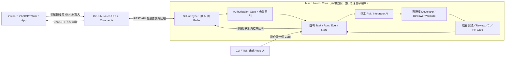
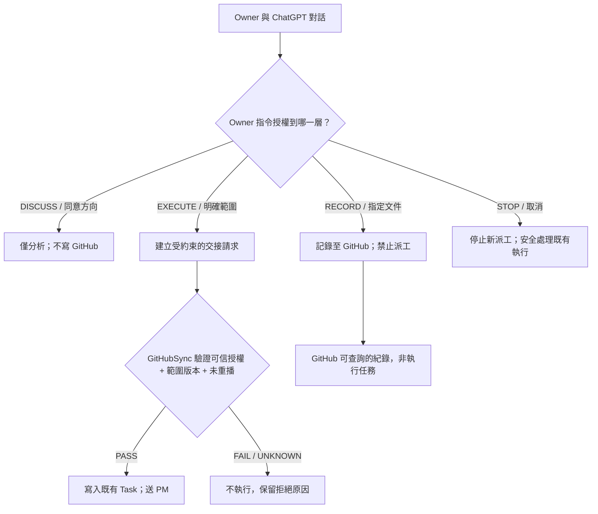
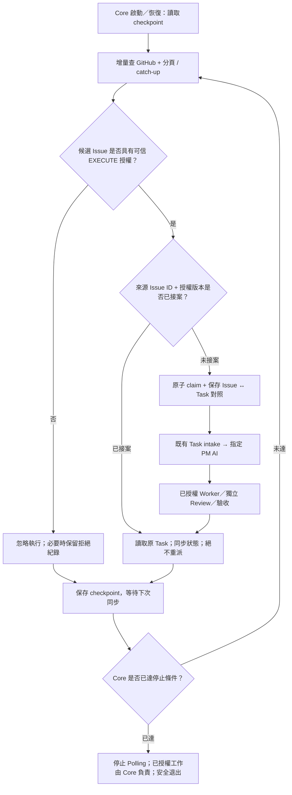
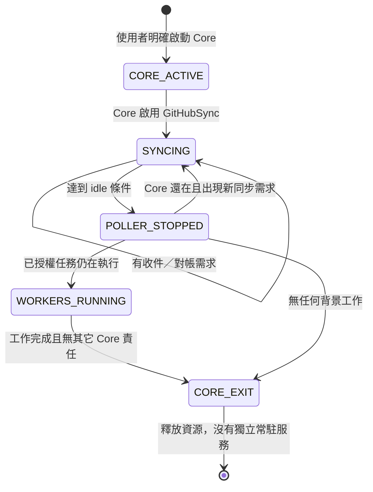

# llmtool 產品需求、操作入口與背景執行 — 討論會議紀錄

- **日期：** 2026-10-21（Asia/Taipei）
- **性質：** Owner 與 ChatGPT 的需求討論／決策紀錄，供後續正式規劃參考。
- **效力：** 下文「Owner 已確認」才是本次產品需求；「建議、待定」不等於 Owner 已接受。
- **2026-10-22 後續更新：** 新增第九節，記錄 ChatGPT ↔ GitHub ↔ llmtool 統一接案、權限分離、Core 自主管理 Polling 與架構／流程圖；本次另獲授權同步 Roadmap／相關文件，舊次限制按歷史保留。
- **本次工作範圍：** 只保存會議紀錄；不代表 Roadmap 已更新、功能已實作、任務已派送、預算／執行／資料外送權限已核准。
- **管理要求與後續授權：** 目前仍在定義產品階段，不得自行派工或修改 Roadmap。原本只授權建立會議紀錄；後來 Owner **另行要求** PM 將整體討論報告上傳 Git 供 ChatGPT review，因此產生僅含報告的 Draft PR #255；這不等於產品開發或合併授權。現在 Owner 明確要求**更新本既有會議紀錄**，本次直接更新此檔，不新增 PR／Issue、不派工。

## 一、產品定位（Owner 已確認）

llmtool 應是使用者直接操作的**通用本機 AI 協作工具**，不是某個 Codex／Claude／OpenCode CLI 的附屬設定，也不是只能裝在 Owner 自己 Mac 上的私人專案。

- **llmtool 本身沒有 AI 智能，也不做語意判斷或自主的模型／任務分配。** 它負責介面、已授權的工具與 Provider 連接、Task/Run/Session/事件狀態、執行與交接、記錄、監控及結果呈現；可以有確定性的輔助功能。
- **至少要連上一個使用者指定的 Integrator／PM AI，才能執行需要 AI 企劃與開發協作的流程。** PM AI 負責理解需求、拆解、決定 Developer/Reviewer 等角色、模型及分工；使用者也可以自行指定角色／模型。llmtool 不取代這些決策。
- **節省大型付費模型 Token 的方法由 Integrator／PM AI 或使用者決定。** llmtool 提供可用路線與可核對的用量／產出紀錄，不自行另造模型成本評分或智慧 Router。
- Codex、Claude、OpenCode 等可作為背後的 CLI／Agent runtime，並不意味著使用者要先進入其中一個 CLI 才能操作 llmtool。

## 二、六項使用者行為：決議結果

| 編號 | 主題 | Owner 決議 | 完成時應看到的行為（需求，不是已實作） |
| --- | --- | --- | --- |
| 1 | 原生 CLI 入口 | **是** | 使用者直接啟動 `llmtool`，輸入開發需求；不需先開 Codex／Claude／OpenCode CLI，也不需人工傳遞一般工作提示。 |
| 2 | PM AI 與角色／模型分配 | **是** | llmtool 至少連接一個**指定的 Integrator／PM AI**；其他 AI 角色與模型可以交給 PM 決定，或由使用者指定；llmtool 不自行做 AI 分工判斷。 |
| 3 | 多任務並行 | **可以** | 同時處理多個互不衝突的開發任務，各自追蹤狀態、負責 Agent、結果及阻塞；具體排程與衝突管理由 PM／既有安全機制處理。 |
| 4 | 關閉介面後是否繼續 | **採用 A：繼續執行** | 關閉 llmtool CLI／Web UI 介面後，已啟動的本機工作繼續背景執行；重新開啟可查詢任務與進度，不須重新送需求。 |
| 5 | PR 合併 | **是，由 PM AI 決定** | PM／Integrator 按已授權的 Git、測試、獨立 Reviewer、CI 等驗收規則決定合併；這不是跳過權限或自動合併所有 PR 的許可。 |
| 6 | 公司 LLM Developer | **是** | PM 或使用者可把適合的真實開發需求經 llmtool 交給公司 LLM；產出包含程式碼／測試提案，品質須通過必要的客觀測試與獨立審查。 |

### 第 4 項背景工作：明確的產品語意

Owner 原話：「**第④項決定採用A：關閉llmtool介面，已啟動的工作繼續在本機背景執行。**」

- **關閉介面 ≠ 取消 Task。** 背景執行程序須獨立於 CLI／Web UI 的顯示生命週期。
- 再次開啟介面應能看到可信的 Task/Run 狀態、歷史及最新結果；不得把程序退出或失聯直接宣稱為完成。
- 單一 Agent／Provider 異常終止時，留下正確中斷／未知證據，交由指定 PM 決定是否恢復、重新派送或停止。
- 電腦睡眠、斷網、關機期間**不宣稱本機仍持續執行**；之後先核對實際狀態，再依已驗證的恢復能力處理。
- 這個需求**不等同**要求首版就具備 24 小時無人值守、開機自啟、遠端常駐服務或雲端 Worker。前景／背景 Supervisor 的技術方案尚未決定。

## 三、公司 LLM 的原始目標與 Token 規則糾偏（Owner 已澄清）

Owner 要求的是：**透過 llmtool 讓公司 LLM 承擔適合的實際開發工作，減少 Codex、Claude 等大型付費 AI 的 Token 使用，但公司 LLM 的開發成果必須有品質。**

與此目的不符、**未由 Owner 提出或核准**的通用規則，不得歸因為 Owner 決策：

- 「Reviewer Token Usage UNKNOWN 就不得 APPROVE」。
- 「Token 超過自行設定的節流目標，就禁止有效的程式碼審查通過」。
- 「只因 Token 超過原定目標，就通用地限制之後的開發或停止任務」。

**品質驗收與 Token／成本統計須分開。** UNKNOWN 應照實記錄 UNKNOWN、不能改寫成零，也不能聲稱已驗證節流成功；但成本資料缺失本身不是 Code Review 品質不合格。其他確有獨立授權來源的安全、資料外送、金錢支出或 Provider 執行控制，不因本次澄清而自動取消，亦不得誤稱出自上述節流目標。

公司 `gw` 應是選用的 Provider／Developer 路線，而不是通用 llmtool 的必要依賴。實際程式碼套用、Shell/Git 執行和最終驗收由相應獲授權環境與角色執行；模型文字輸出不自帶檔案／權限。

## 四、llmtool CLI、Web UI 與其他人的電腦

### CLI（Owner 已確認為正式入口）

- 在 Terminal 啟動 `llmtool` 後，可直接提交實際開發需求，連接指定 PM，收到任務 ID 與進度、測試／Review／PR 結果，必要時作 Owner 決策。
- `llmtool chat`／TUI 已存在基本文字對話能力，但**不是**已驗收的多 Agent 自動開發入口；不能把 CLI 能聊天誤當成產品完成。
- 使用者需要能找到 llmtool 的下載／安裝及初次設定說明。下載來源、打包與發佈方式**尚未決定**；不得把未發佈的安裝管道說成已上線。

### Web UI（Owner 已提出並再次確認的產品功能）

**最新排序更新：本機 Web UI 已定為 A12.2，排在 Mac CLI 與 A12.1 Telegram 之後。**

Owner 在 2026-10-19 已討論透過 Web 觀看 llmtool 的 Agent 工作流、資料流、狀態與監控數據，並希望有更有未來科技感的動態視覺化。本次進一步確認 **Web 不只看監控，也必須可以輸入提示／需求、提交和追蹤工作、查看結果與必要的操作／授權**。

- 觀察需求：使用者需求 → PM 分工 → Developer（Codex／OpenCode／公司 LLM 等）→ 測試 → 獨立 Reviewer → 修復 → PR/CI；真實顯示等待、進行、阻塞、完成、交接結果與相關證據。
- 操作需求：從 Web 下需求、看 PM 回應、管理及追蹤任務，經**同一套既有 llmtool 後端與權限契約**提出必要操作。Web UI 不應另有自己的 PM 或協調引擎。
- 專案目前存在 Terminal Monitor／Activity 規劃，**不能因此宣稱 Web UI 已經交付**。
- 依賴、UI 架構、版面設計、實際第一版 Web 功能邊界及對外存取方式**尚待規劃與驗收**。

### 其他人的電腦（Owner 已確認為產品方向，實作時序尚待正式排定）

llmtool 將來應可分享給其他使用者安裝在**自己的電腦**，使用自己的 Provider／CLI 帳號與 Git Repo；不能要求拿 Owner 的 Mac 路徑、公司 VPN、帳號或憑證才能運作。這是**每個人獨立安裝的工具**，不等同於共用一台多人租戶 SaaS。

- 既有 [PR #237 移植性評估](https://github.com/davidcatcat/davidcattoolsproject/pull/237) 記錄了硬編碼路徑、固定 Repo、CLI 版本、Host 登錄及 Windows 限制。其「先保持個人 Mac 工具」是作者建議，**不是 Owner 最終產品定位決策**。
- **Owner 後續已正式決定優先順序：** 先完成自己的 Mac CLI，再做 A12.1 Telegram（需求尚待討論）、A12.2 本機 Web UI，最後才安排其他人的電腦和 macOS／Linux／Windows 支援；各平台的內部先後及發佈方式仍未決定。不得再將「其他人的 macOS 安裝先於 Web」記為最新 Owner 順序。

## 五、A11c 與後續階段：本次釐清的界線

- **A11c 核心協作目標：** 透過至少一個指定 PM AI 完成真實任務 → PM 分派 → 已授權 Developer 工作 → 測試、獨立 Reviewer 與必要修復 → PR-or-STOP／合併決策的可信閉環，且不需要 Owner 人工傳話。
- **A11c 的使用者入口需求：** Owner 已確認 llmtool 原生 CLI 必須直接接收需求，並在使用者關閉介面後繼續管理本機背景工作。只有「從 Codex CLI 手動啟動」不符合完整使用者入口的驗收。
- **Owner 後續確認 A12 的分項：** **A12.1 — Telegram**（需求範圍、操作／通知／授權及驗收待討論）、**A12.2 — 本機 Web UI**（監控整個工作流，也能下提示／提交任務、追蹤及必要操作）。目前優先交付 Mac CLI，A12.1 再於其後、A12.2 再後；不能把過去提出的 Web-first 排序當作最新決策。**「V1.0」等版號及詳細 DoD 仍未正式決定。**
- **其他人獨立安裝**仍是確定的產品方向，但 Owner 已決定排在 Mac CLI、Telegram、本機 Web UI 之後。具體版本與各平台順序待後續規劃。
- 保持既有 A-roadmap／安全驗收的可追溯性，避免為同一需求新建重複 PM、Controller、審查系統或臨時管理階段。

## 六、2026-10-21 後續決議與規劃審查

> 以下為首次會議紀錄之後，Owner 與 Codex Integrator／PM 持續討論，再由 ChatGPT 唯讀審查後補記的內容。**明確標示「Owner 已確認」與「PM 建議／尚待修正」；不得將兩者混為一談。** 參考 [PR #255 的彙整報告（Draft）](https://github.com/davidcatcat/davidcattoolsproject/pull/255)。該報告目前不是已合併的現行規則。

### 6.1 最新交付順序（Owner 已確認）

| 順位 | 階段／產品 | 決議及界線 |
| --- | --- | --- |
| 1 | **A11c — Owner Mac 原生 llmtool CLI** | **首先交付。** 使用者直接輸入真實開發需求、指定至少一個 PM AI；PM 或人決定角色／模型；llmtool 管理多任務、授權內的開發交接與背景生命週期。關閉介面後工作繼續，重開可接回。 |
| 2 | **A12.1 — Telegram** | Owner 指定優先於 Web，**實際需求尚未討論定案**。是否僅通知，或還要與 PM 對話、提交需求、操作／授權、顯示詳細結果，均不可預先當成 Owner 已接受。 |
| 3 | **A12.2 — 本機 Web UI** | 完整 AI 工作流的監控、視覺化資料流，並可輸入提示、追蹤／提交任務及必要操作；與 CLI／Telegram **共用同一 llmtool 核心與權限語意**，不另建 PM／Controller。細部界面、驗收與部署設計待後續討論。 |
| 4 | **其他使用者／其他電腦及平台** | 產品長期仍應可供他人以自己的帳號、憑證、Repo 獨立安裝；macOS／Linux／Windows 等細部排序及發佈方式留待後續，不阻擋第 1 階段。 |

**這是 Owner 最新確認的排序，取代之前「Web 先於 Telegram」以及「先讓其他人的 Mac 安裝」等 PM 初步建議。** 不擅自建立額外 A 系列 Milestone。

### 6.2 公司 gw 暫時無法連線（Owner 已確認）

Owner 同意：**公司 `gw` 暫時不可用時，可以先交付清楚標明限制的 Mac CLI 預覽版**。這是避免單一路線拖住其他已具備條件的功能，不代表公司 LLM 的開發與節流目標被取消。

- CLI 核心必要功能與各適用安全／品質驗收仍須具備；只有公司 `gw` 這條路線的實際開發／可用性可以標明 **UNAVAILABLE／NOT_VERIFIED**。
- 不得宣稱六項產品需求全部驗收、公司 LLM 已穩定自動寫程式，或已證明整體 Token 節省。
- 曾有經測試／獨立審查並被採用的公司模型程式碼案例，例如 [PR #213](https://github.com/davidcatcat/davidcattoolsproject/pull/213)；也有後續逾時、無 Patch 的試行。兩類紀錄都應保留，**有限成功 ≠ 完整自動閉環 PASS**。

### 6.3 指定 Integrator／PM AI 失聯時（Owner 已確認）

Owner 原話：「**原本指定的integrator/pm無法使用的時候,其他ai正在進行的工作就先繼續做,做到需要pm在停止,新的派工項目也先暫停**」。

- 已開始且**已獲授權、不需新 PM 判斷**的 Developer／Reviewer 工作可以繼續到其現有範圍的適當邊界，保存輸出、測試與證據。
- 遇到需要 PM 拆分、追加授權、跨 Agent 協調、合併、修正方向的節點時，該工作進入 **WAITING_PM／BLOCKED** 等真實等待狀態；**新派工暫停**。
- 不會自行換 PM、擴張存取範圍、使用未授權付費模型、跳過審查或冒稱已完成；PM 恢復時核對實際 Task／Agent／Revision 狀態，避免重送任務、產生第二個 Writer。
- 此條與「關閉 llmtool CLI 介面後工作繼續」相容；**關閉介面不等於 PM 失聯**，應以執行與連線實際證據判斷。技術實作與完整驗收尚未完成。

### 6.4 A11c、G3、M2、A11c.2 的界線（審查修正方向，Owner 已同意）

PM 在 [PR #255](https://github.com/davidcatcat/davidcattoolsproject/pull/255) 提出 A11c 交付條件：指定 PM 的原生 CLI 入口、Task／Run／Session 持久化、真實多任務並行、背景執行與重接、可信 Developer → Reviewer → PM 交接、自動退修與合併／STOP。**方向已由 Owner 同意；實際完成與驗收仍待實作證據。**

ChatGPT 唯讀審查指出：**不宜重新擴張既有 G3 的完成定義**，否則會把已安排的「三 Agent 真實閉環交接」驗收重做或變成更多新關卡。Owner 表示同意這項修正：

- **G3：** 保留現行 Owner outcome reporting 已核准的 **Integrator → Developer → 獨立 Reviewer → 必要修復／測試 → Integrator PR-or-STOP** 真實交接、ACK、喚醒與結果接收證據，不以新產品入口要求改寫 G3 原義。
- **M2：** 仍是原生 AI Agent 協作閉環的核心成果；不得以人工轉貼提示、假事件、外部 CLI 人工操作或 CI 綠燈單獨宣稱 M2 PASS。
- **A11c／A11c.2 Mac CLI 交付驗收：** 另外檢查**使用者直接操作 llmtool CLI、指定 PM、至少兩個適當隔離的真實並行任務、關閉 CLI 後仍背景執行、再次開啟接回、PM 失聯的有界等待**等最新產品需求，並搭配原有真實交接和獨立品質 Gate。
- G1–G4 仍是**成果回報檢查點，不是新產品 Milestone**；詳細 DoD、技術方案與正式 Roadmap 描述需在原有架構下整理，無須為此增建另一套管理系統。

### 6.5 開發規則整合與避免過度停工（方向獲 Owner 同意；規則尚未修改）

Owner 指出過往經常被分散在不同文件的規則擋住開發。PM 唯讀盤點發現 `AGENTS.md`／`CLAUDE.md` 已精簡，但 `ROADMAP.md`、`WORKFLOW.md`、`README.md` 仍混合現行指令、歷史契約和路線專屬的限制，容易互相誤用。

**Owner 已同意的原則：** 先把必要功能完成；遇到問題持續分析、修復與驗收；只阻擋**真正受影響的工作或危險動作**，不因無關 Bug、個別模型／VPN 不可用而停止整個專案。例行實作和技術修正由 PM／Integrator 在既有授權內處理，重大產品／權限／必要 Owner 決策才升級。此原則**不是**免除安全、資料保護、獨立審查、CI 或真實 Mac 驗收。

建議沿用現有文件而不另建治理系統：`AGENTS.md` 管現行共通授權，`ai-team-delivery` 管派工／品質流程，`safe-git` 管 Git／Worktree；`WORKFLOW` 管必要工程交接，`ROADMAP` 管產品路線與 DoD，`README` 管使用說明，舊版本移入決策／歷史文件。這是**整合提案，尚未實施**。

具體清理方向（不是今天的授權刪改）：

1. 公司 `gw` 已可被選為**提出真實程式碼／測試的 Developer 路線**；舊的 triage-only 文字不得擋住新決策，但公司模型仍不擁有檔案、Shell、Git、Review 或 Merge 權限。
2. OpenCode 一般直接 Developer Session 與特殊 D8 Host／Worker、C1B 試行路線的 cap、Grant、Retry、Host admission 不可混用；各路線保留各自實際授權。
3. Token UNKNOWN 僅表示統計未知，不得用自行設定的節流目標否決有效 Code Review；真正有獨立授權來源的費用上限、資料外送與 Provider 安全控制仍保持。
4. Worktree/單一 Writer、敏感資料、合法操作、獨立 Security／Functional／QA、適用 exact-head CI、Mac Live 證據與防重播等**必要保護繼續有效**；合理精簡重複前置檢查，不得直接跳過來源／檔案身分驗證。
5. 每條具阻擋性的規則應標明**授權來源、適用模式、真正阻擋的操作、由誰處理、何時可恢復**；已封存的 F1/Pickup 不能記成目前還有執行中的產品能力。

**ChatGPT 審查發現的第一項待修正處，Owner 已同意：** `AGENTS.md`、`WORKFLOW.md` 和 [Owner Outcome Reporting v1.1](../../docs/governance/llmtool_owner_outcome_reporting_v1_1_20261019.md) 對 Owner 升級／授權界線的說法不完全一致。後續整合時應**逐條比對原始授權與適用範圍、建立單一現行入口**；不能僅憑 `AGENTS.md` 的三項問答條件便一概取消其他實質資料外送、危險權限、支出或正式 GO／NO-GO 所需的決策／授權。

Owner 同意以上報告方向和兩個審查修正點，也說明「**之後有問題我們再來修正，維持目前持續改善的做法**」。這不是放棄既定安全 Gate，也**不是**宣告 PR #255 已修好、已核准合併或正式修改規則。

### 6.6 GitHub 狀態與本次明確工作範圍

- [PR #249](https://github.com/davidcatcat/davidcattoolsproject/pull/249)：Owner 要求關閉，**CLOSED／NOT MERGED**。先前的 Web-first Roadmap 草案不具現行授權。
- [PR #255](https://github.com/davidcatcat/davidcattoolsproject/pull/255)：Owner 另外要求「整段討論做成報告上傳 Git」而建立的**文件 Draft**。ChatGPT 已完成**唯讀分析並提出 2 點 REVISE**（Owner 權限規則來源；G3 邊界），Owner 表示同意；**修訂 PR 內容與是否合併仍是另一個實際 Git 步驟，不由本會議紀錄直接執行或冒稱完成**。
- 目前只核准將上述追加決議寫入**這份既有會議紀錄**，不修改 `ROADMAP.md`、`WORKFLOW.md`、`AGENTS.md`、Skills、產品程式碼，不新增 PR／Issue 或派 Developer。

---

## 七、仍待討論／技術調查事項

這些是**待討論問題，不是已核准開發工作**：

1. `llmtool` 的直接輸入形式、命令模式、首次設定與安裝／下載發佈體驗。
2. 使用者指定 PM AI／Agent 角色或模型時，具體設定介面、覆寫優先順序及模型無法使用時如何告知。
3. 背景 Task Manager、程序生命週期、睡眠／重啟後的恢復證據與使用者停止操作的詳細設計。
4. 多任務／多 Worktree 的最大併發、排程、衝突解決與工作狀態介面。
5. Web UI 的第一批驗收功能、登入／本機存取安全、圖表／動畫設計及部署方案。
6. 已決定的交付順序如何落實在現有 A11c、A12.1、A12.2 的正式 Roadmap；確切版本命名、交付切片及逐項 Definition of Done 尚待定稿。
7. 「已驗證節流」需要的品質等價及模型消耗數據，與安全限制的獨立授權來源，須維持分離。

## 八、相關 GitHub 來源與本次限制

- [A11c 原有協調規劃：Issue #120](https://github.com/davidcatcat/davidcattoolsproject/issues/120)
- [llmtool Roadmap（目前仍以 main 為正式文件）](../../tools/llmtool/ROADMAP.md)
- [llmtool 初始產品定位／安裝與 Chat/TUI](../../tools/llmtool/README.md)
- [llmtool 跨電腦使用評估：PR #237](https://github.com/davidcatcat/davidcattoolsproject/pull/237)
- [現有 Activity 監控需求：Issue #225](https://github.com/davidcatcat/davidcattoolsproject/issues/225)
- [先前 Roadmap 草案：PR #249 — CLOSED / NOT MERGED](https://github.com/davidcatcat/davidcattoolsproject/pull/249)

**紀錄更新不等於工作授權。** 保留 Owner 決定與 PM 建議的區別，不因本檔而建立或重開 PR／Issue、派發 Developer、修改 Roadmap／現行規則、合併 PR #255，或聲稱產品功能已驗收通過。後續規劃正式修訂及開發仍須相應授權。

## 九、2026-10-22 ChatGPT ↔ GitHub ↔ llmtool 自動交接：Owner 決策與架構

> **本節為 2026-10-22 Owner 新增的明確決策，取代第八節「本次只准修改會議紀錄」等對舊次修改範圍的描述，但不回寫或抹除 2026-10-21 歷史授權。**
>
> **本次 Owner 授權範圍：** 將討論、決策、可渲染架構圖／流程圖寫入既有會議紀錄，納入既有 A-roadmap 並同步相關文件。**不授權**實作 GitHubSync、建立開發 Issue、派發 PM／Developer、安裝或啟動任何背景程序、修改產品程式碼、建立 Runner／Webhook／launchd、合併 PR，亦不視為任何既有 F2/G3/M2 Gate PASS。
>
> **狀態：** 產品需求與設計方向已由 Owner 明確確認；實作方式、參數和端到端行為仍須驗證。GitHub 上的文件或圖表不代表 Mac 已安裝或已運作。

### 9.1 目標、非目標、既有分工

**最終目標：** Owner 直接在 ChatGPT 網頁／手機 App 討論與下達**明確授權**的任務，ChatGPT 經已連接且具權限的 GitHub 工具建立或更新正式交接紀錄；Mac 上已運行的 llmtool Core 讀取並安全接收，指定 PM AI 自主拆分並派給 Codex、OpenCode、Claude、公司 gw 等已授權可用的 Worker；工作經測試、獨立審查、PR/CI 和必要 Mac 驗收，結果回傳 GitHub，ChatGPT 可在下一次對話中直接查證。Owner **不再把提示詞或 Worker 回覆在 ChatGPT 與 TUI 間反覆複製貼上**。

- **角色不變：** ChatGPT 是 Owner 的遠端需求／規劃入口；GitHub 是可追溯的傳遞媒介，**不是** PM、任務執行者或授權機關；llmtool Core 是確定性執行、政策、狀態、證據與交接層；語意拆解、路線選擇由 Owner 指定的 PM／Integrator AI 決定。
- **不同額度：** 這個架構使用 ChatGPT 一般對話和 GitHub 交接，不等於 llmtool 能使用 ChatGPT 一般聊天額度做無人值守推論。PM／Worker 的 Codex、Claude、OpenCode、公司模型之用量及限制仍各自適用。不得將「GitHub 交接不呼叫模型」解釋為「AI 任務不消耗額度」。
- **不承諾立即遠端喚醒：** ChatGPT 及 GitHub 並不能憑空啟動一台沒有接收端的 Mac；Core 完全退出時，新 Issue 只會保留於 GitHub，等下次明確啟動 Core 後補收。ChatGPT 也不會因 Issue 更新就自動在目前聊天中主動發訊息。
- **界面與 Core 分離：** CLI、TUI、未來 Web UI 是操作入口，**不各自實作 Poller、PM、Supervisor**。關閉顯示介面不等於取消已授權工作。

### 9.2 Owner 已決定：增量 Polling + Core 生命週期；不採獨立常駐方案

採用 **llmtool Core 內建 GitHubSync（增量 Polling）** 作為現階段方案；借鑑 Claude Code 的 **Session／任務生命週期管理原則**，不是讓 Claude 模型定時發問，也不是照搬 Claude GitHub Actions。

1. 由 Owner 明確啟動 llmtool Core 後，Core 在已配置且允許 GitHub 接案的情況下自動啟動 GitHubSync；先補查上次成功 checkpoint 後的變動，再按設定週期查詢。**不需 Owner 另外啟動 Poller**。
2. 不安裝 macOS 開機／登入自動啟動項目，不新增獨立 `launchd` 排程、Daemon、Self-hosted Runner、公開 Webhook、常駐 AI 監控 Agent 或第二套 Supervisor。
3. GitHubSync 只做 GitHub API 查詢、接案去重、核對授權、狀態同步與結果回寫；**輪詢不呼叫 AI**。實際 PM／Worker 工作使用 A11c 現有 Core／Task／Session／Executor／Review 契約。
4. 有仍在執行的已授權工作時，Core 負責其背景生命週期，**關閉 TUI／Web UI 不應直接殺掉工作**。Poller 可在不再需要接收／對帳時獨立停止，結果回報可由 Core 事件驅動，不必維持空轉查詢。
5. 當沒有介面使用、沒有待接收／對帳工作且空閒條件成立時，GitHubSync **自動停止**；所有需要 Core 負責的工作也已結束後，Core 可有序釋放資源並退出。不得留下沒有監管的 macOS 常駐程序。具體 idle TTL、同步間隔與是否延後停止為**可配置參數、尚待實測**，先前討論的 60 秒／5 分鐘**不是已核准硬值**。
6. Mac 睡眠／關機／Core 終止期間，不宣稱仍可接案；下一次 Core 啟動必須進行 catch-up，不把離線期間的 GitHub 新 Issue 漏掉。Core 開啟但 PM 額度用盡時，保留 WAITING_PM／BLOCKED 真實狀態，不自行換 PM 或擴張模型付費權限。

### 9.3 架構圖（規劃、非現況驗收）

此圖**不代表** GitHub 可以任意執行 Mac 指令，也**不代表** ChatGPT 直接擁有 llmtool 的模型 Provider 權限。

### 9.4 意圖與授權狀態（嚴禁從討論擴張成執行）

| Owner 表達的意圖 | 授權結果 | ChatGPT GitHub 寫入 | GitHubSync / PM 動作 |
| --- | --- | --- | --- |
| **DISCUSS**：研究、Review Repo、評估、規劃、「這方向不錯」 | **唯讀**；同意方向不等於執行 | 不建立 Issue／PR、不修改既有項目 | 無收件任務 |
| **RECORD**：「寫成會議紀錄／存到 GitHub」 | 只允許指定文件／紀錄 | 可以在明確範圍內保存**不帶執行授權**的紀錄 | 不得因文件、Issue 或 Label 自動派工 |
| **EXECUTE**：「交給 llmtool PM 開始做」及明確範圍 | 建立**限定內容及版本**的正式交接授權；仍受原有安全 Gate | 只在授權後建立／更新可接案紀錄 | 接收前再驗證可信授權、範圍、任務版本與冪等狀態，才送指定 PM |
| **STOP / CANCEL**：明確停止新派工或取消任務 | 阻止後續派工；已執行作業按已核准清理機制處理 | 變更相關控制紀錄 | 不自動殺進程、不擴權、不假報完成 |

**雙重關卡：**

1. ChatGPT 端先按 Owner 的**明確操作授權**決定是否寫 GitHub；不可將「好」、「可以」、「方向同意」、一般評論或衍生建議自行升格為建立 Issue 或開發授權。
2. llmtool GitHubSync **不得以 `llmtool:ready` Label、Issue 文字、ChatGPT 自述或 PR Comment 作為獨立授權憑證**；正式實作須能驗證具可信身分與來源的 Owner 執行授權、所核准的 scope/版本 digest、可撤銷性與重放保護。**若無法證明授權來源，Fail Closed；不接案／不派工。** GitHub 帳號、App 身分與 Owner 授權的可證明映射是 POC 必須解決的問題，現在不能聲稱已實作。

### 9.5 增量同步、任務識別、避免漏單與重複執行

- **唯一索引：** `repository_id + issue_id` 代表來源 Issue；另外保存 `task_id`、核准任務版本 digest、owner authorization reference、最後成功同步 checkpoint 與接案／回報狀態。**Issue number 單獨不足以跨 Repo 去重**；`updated_at` 只作為增量檢索條件，不能視為新派工證據。
- **首次／恢復：** 從持久化 checkpoint 以 `state=all`、必要 Label、`since`、`sort=updated`、`per_page<=100` 與分頁查詢；對因 Label 更動或 API 過濾可能漏看的候選保留週期性 reconciliation。跨過 Mac 離線數週／數月必須補查，不設定「只接最近 N 天」的硬門檻。
- **增量：** 每次成功持久化處理後才推進 checkpoint；時間窗適度重疊，按 Issue ID 去重。GitHub 回覆失敗、網路斷線或回報失敗時不得冒充已同步完成。ETag 可用來節省 API 使用。
- **原子接案：** 在有多個 Poller、程序崩潰、API 超時或 GitHub 標籤回寫失敗時，**同一來源授權版本最多建立一個 Task**；須有持久化且可復原的 claim／Task 對照，避免「PM 已收件但尚未記錄 ID」造成重複派工。不得僅憑 Label 實現 exactly-once 假象。
- **狀態隔離：** GitHub Open/Closed 和 Label 是**外部展示**；llmtool Task／Run 實際事件和驗收證據才是執行狀態依據。`claimed`、`running`、`blocked`、`done` 等 Label 若採用，僅作投影，不可反向賦權。Issue 被 Reopen、留言、修改 body 或 Close 皆**不自動重跑／撤回既有工作**；需求版本超出核准摘要時須重新授權。
- **授權交接：** 現有 `llmtool task submit` 可以持久化 PM 請求／回覆，但**其當前實作不是已驗證的 Developer 自動啟動器或 GitHub inbox**。GitHubSync 只銜接經安全驗證的原 Task intake；PM 實際派工還需 A11c 真實交接機制通過。
- **回報：** 在實際 Task ID、Worker／Review、PR HEAD、CI、Mac Gate 等證據具備後同步結果；缺證據時顯示 PENDING、BLOCKED 或 UNKNOWN，不能把 GitHub Comment 或 Merge 當成 Runtime DONE。

### 9.6 Core、介面、Poller、Worker 生命週期分開

- **啟動時機：** 使用者明確啟動 llmtool Core 或透過既有前端要求啟動時，由 Core 根據配置啟用 GitHubSync。**Mac 開機、使用者登入、打開不相關 App** 不自動啟動。
- **Poller：** 沒有需要的接案／對帳活動，且達可配置空閒門檻時自動停止；不可為了「未來可能有任務」而永久佔住 Mac；不留下獨立 Runner／launchd。**Core 完全退出後不承諾即時遠端接案**。
- **Worker：** 界面關閉不取消已授權且仍在工作的 Worker；中斷、PM 失聯與不明狀態按既有 Gate 留存，不能由 Polling 自行重派。所有有責任的背景工作完成，Core 才能有序結束。
- **結果同步：** 若 Poller 已停，但 Core 仍在管理執行，完成事件可以觸發一次性結果同步；避免為了回報而維持永久空輪詢。
- **尚待實測參數：** Poll 間隔、idle TTL、對帳週期、batch/page、429/backoff、錯誤重試、停止後再次啟動條件。曾討論 60 秒 Polling、5 分鐘 idle 只是**可供測試的候選值**。

### 9.7 為何選 Polling、暫不選 Runner / Webhook

| 比較 | 內建增量 Polling（Owner 決定） | GitHub Self-hosted Runner | 公開 Webhook |
| --- | --- | --- | --- |
| Mac 入站公開 Port | 不需 | 不需 | 需要可被 GitHub 到達的 HTTPS 接收端／Tunnel |
| 平時維護 | Core 內建短週期檢查 | 要維護 Runner、Workflow、安全隔離 | 要維護 HTTPS 服務、簽章與重送 |
| 離線一個月 | checkpoint + reconciliation 補收 | Actions Job 排隊有時限，仍需補掃 | 要處理漏送／重送與補掃 |
| Owner 不要額外背景程式 | **符合**，可自停 | 不符合本階段最小架構 | 不符合本階段最小架構 |
| 語意派工 | 仍由 PM AI 決定 | 仍由 PM AI 決定 | 仍由 PM AI 決定 |

沒有「Webhook 自動替 GitHub 派工」或「Runner 免費就應優先採用」的推論。若未來確實需要 Core 停止時仍立即遠端啟動本機工作，須**另開重大產品／運維決策**，不得悄悄加入常駐服務。

### 9.8 Roadmap 依賴與最小驗收（目前不啟動實作）

1. **先完成 A11c**：現有 Core／背景 Task／Session／PM／Worker 真實交接和 A11c.2 驗收是前置條件；GitHubSync **不是 A11c / Mac CLI 上線阻擋項**。
2. **列於既有 A12 遠端入口擴充**：沿用 A11c Task／Run／Event／Approval；與已確認 A12.1 Telegram、A12.2 Web UI 共用同一核心。**保留既有交付順序**（Mac CLI → Telegram → Web UI → 其他平台），GitHubSync 的細部插入順序由後續排程決定，不偷設新的 A-number milestone。
3. **第一個 POC 只做接案及回報閉環**，不複製既有 Supervisor、不重作 PM；文件／測試與正式啟用分離。真實入口仍必須維持現有審查、安全、費用與資料外送 Gate。

**日後完成條件（Definition of Done 候選）：**

- DISCUSS 不寫 Git；RECORD 只寫授權文件而永不派工；EXECUTE 只有可信授權及指定 scope/digest 通過才接案；偽造 Label、修改 Issue 與舊授權重播都必須 STOP。
- 同一 GitHub Issue／授權版本，即使重啟、重覆輪詢、崩潰／API 重試，也不重複建立 Task 或 Developer；跨 Repo Issue 編號不混淆。
- Mac 長期離線後自動補查全部符合授權的候選，且對遺失／不完整 checkpoint 有保守修復；PM 不可用時呈現等待，不假報已派工。
- 工作執行、獨立 Review／CI、必要修復、PR-or-STOP 和結果回報都以真實證據綁定，Owner 不須再往返複製提示詞；ChatGPT 可查詢已回傳 GitHub 的紀錄，但不冒充即時推送通知。
- TUI／Web 關閉後，已授權背景工作繼續；Poller 在 Core 控制下閒置自停；全部工作結束後無無人管理的背景程序；不安裝 macOS 開機服務。
- Docs/POC/正式實作分開審查。實測相容 Mac 睡眠、斷網、重啟及 GitHub API Rate Limit，標出 PASS/FAIL/BLOCKED/NOT_TESTED，不能用 Mermaid 圖或假測試宣稱通過。

**技術參考（外部）：**
- [GitHub REST Issues API（labels/since/state/per_page）](https://docs.github.com/en/rest/issues/issues)
- [GitHub Webhook Best Practices](https://docs.github.com/en/webhooks/using-webhooks/best-practices-for-using-webhooks)
- [既有產品 Issue #120](https://github.com/davidcatcat/davidcattoolsproject/issues/120)；[架構決策 Issue #172](https://github.com/davidcatcat/davidcattoolsproject/issues/172)

**會議決策到此為止。此處是經 Owner 授權的文件規劃／更新，並非對 llmtool 下達新任務的 EXECUTE 授權。**

