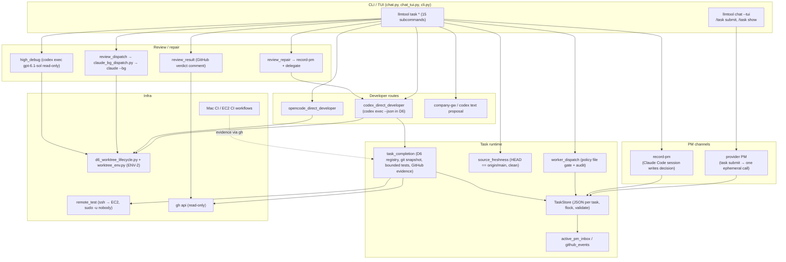
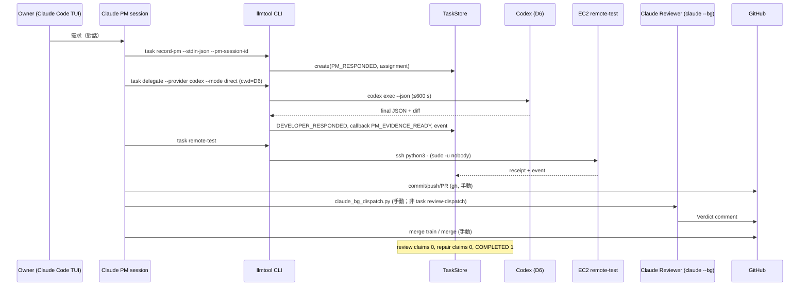
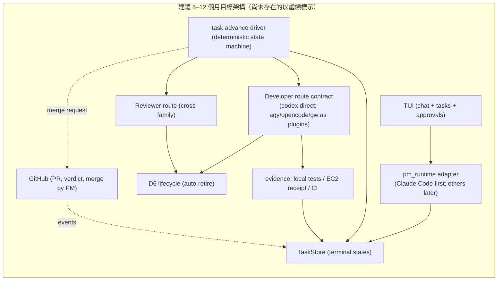

# DavidCatToolsProject — Independent Full Repository Technical & Architecture Audit

- **審查日期：** 2026-10-28（Asia/Taipei）
- **Repository：** `davidcatcat/davidcattoolsproject`
- **審查 Snapshot SHA：** `139a62c0483560be4e7a0aadd76c82652a8a2cd9`（`main`，merge train 10，#507）
- **分析環境：** Owner 提供的唯讀 scratch worktree `owner-scratch-20261028`（detached HEAD at snapshot）；canonical `main` 於分析期間與 snapshot 相同。
- **審查者身份：** Independent Auditor（Claude Fable 5.1，model id `claude-fable-5-1`）。非 PM、非 Developer、非正式 Reviewer，無 dispatch 權限。
- **可觀察 Reasoning Effort：** UNKNOWN（執行環境未向模型揭露此設定）。
- **審查工具與限制：** 唯讀 `git`、`gh` API、本機 TaskStore 與 D6 registry 的**彙總統計**（只讀取狀態欄位，不讀取 prompt／diff 內容）、GitHub Actions run 紀錄。**本機測試執行：NOT_RUN**（Owner 於審查中拒絕在 Mac 上執行測試，改以 CI 紀錄為證據）。未存取任何私人對話、憑證或客戶資料。
- **姊妹報告：** [Report B — Project Evolution & Decision Retrospective](project-evolution-decision-retrospective-20261028.md)、[Report C — Product Owner Playbook](product-owner-playbook-ai-development-20261028.md)、[Executive Decision Brief](executive-decision-brief-20261028.md)。

> 證據標記：**FACT**（有直接證據）、**INFERENCE**（由證據推論）、**OPINION**（專業判斷）、**UNKNOWN**（資料不足）。所有「本機統計」指 2026-10-28 於 Owner Mac 上以唯讀方式彙總的 `~/.local/state/llmtool/tasks`（279 筆）與 `.git/llmtool-worktrees`（489 筆）。

---

## 1. Executive Summary

**核心問題的回答：** 以 Snapshot 的程式碼與本機 Runtime 證據判斷，這個專案目前**不是**一套使用者可以直接操作、可靠完成 AI 協作開發的產品；它是一套**為了管理 AI 開發而持續擴張的流程與框架**，其中「內部開發流程」的完整度遠高於「使用者功能」。這不是推測，而是三組可核對的事實：

1. **使用者入口只有 intake。** `llmtool chat --tui` 的 `/task submit` 只做一次 PM provider 呼叫並存檔，程式本身印出「task intake only; Developer dispatch is not implied」（`tools/llmtool/llmtool/chat_tui.py:889`）。從 TUI 輸入需求後，**沒有任何程式路徑**會啟動 Developer、Reviewer、測試或整合。
2. **WP3 自動閉環的 runtime 已合併但未被使用。** 本機 279 個 Task 中，`task review-dispatch` 的 claim 數為 **0**、`task repair` 的 claim 數為 **0**、`REVIEWER` 事件為 **0**、GITHUB 事件為 **0**；105 個 Developer 完成事件中只有 14 個被 ACK；`task status` 推導狀態 RUNNING 234、COMPLETED 1。所有真實的 Reviewer 派工、修復與合併都由 PM 以手動或 `claude_bg_dispatch.py` 執行。
3. **資源與流程成本已經反噬。** 本機有 374 個 Git worktree（其中 189 個是 Reviewer 用）、D6 registry 489 筆（330 ACTIVE），佔 15 GB，Mac 根磁碟僅剩 13 GB；Mac CI 成功平均 31 分鐘，最近 100 次有 21 次失敗、20 次取消；31 天內 437 個 PR、517 個 Issue、899 個 commit，其中 docs 類 PR（121）多於 feat（100）。

**值得肯定的部分**（同樣有證據）：Provider／行程生命週期、TaskStore 原子寫入、D6 身份綁定、Mac／EC2 runner 隔離、exact-head CI 與敏感資料篩選，是嚴謹且有大量離線測試（116 個測試檔、約 5 萬行）的工程；`nlf` 是一個已完成、跨三平台 CI 的獨立產品；Owner 於 2026-10-21 定義的產品定位（llmtool 無 AI 智能、只做介面／授權／狀態／交接）是正確的架構原則。

**總體判斷（OPINION）：** 方向正確、原則正確，但執行順序倒置：先建了約 3.4 萬行的「管理 AI 的確定性框架」，才在第 28 天開始做使用者入口。最短可用路徑不是再加 runtime 切片，而是**凍結新路線、把現有 record-pm → Codex direct → EC2 receipt → review → complete 這條已經有 runtime 的鏈真正接成一條由 TUI 驅動、可重啟恢復的閉環**，並以一個真實 Owner 任務做 E2E 驗收。

| 指標 | 數值（FACT） |
|---|---|
| Finding 總數 | 37（Critical 2、High 9、Medium 18、Low 5、Info 3） |
| Confirmed Defect | 12 |
| Architecture Risk | 11 |
| Documentation Mismatch | 6 |
| Optimization Opportunity | 6 |
| Unverified Concern | 2 |

---

## 2. Audit Scope / Methodology / Evidence

### 2.1 範圍

整個 Repository：根目錄文件、`tools/llmtool`（含 `scripts/`、`eval/`、`ci/`）、`tools/nlf`、`tools/mac-runner`、`tools/ec2-runner`、`scripts/`、`skills/`、`docs/`、`reports/`、`.github/workflows`。`tools/clinest` 在 snapshot 中**不存在**，只存在於未合併的 Draft PR #392 分支（`docs/clinest-initial-plan-20261026`），本報告將其視為「規劃中的獨立產品構想」，不併入 llmtool 評估。

### 2.2 方法

| Phase | 內容 | 狀態 |
|---|---|---|
| 1 Reconnaissance | 檔案盤點、LOC、模組清單、文件規模、worktree／registry 統計 | 完成 |
| 2 Product／Architecture | 讀取 AGENTS.md、CLAUDE.md、ROADMAP、WORKFLOW、README、會議紀錄、skills、decisions、history | 完成 |
| 3 Source Investigation | 逐行閱讀 `cli.py`、`chat.py`、`chat_tui.py`、`task_submission_cli.py`（submit／delegate／codex direct／complete）、`task_store.py`（I/O、lock、`_update`）、`worker_dispatch.py`、`review_dispatch.py`、`review_result.py`、`review_repair.py`、`high_debug.py`、`active_pm_inbox.py`、`github_events.py`、`source_freshness.py`、`task_status.py`、`remote_test.py`（含遠端腳本）、`codex_direct_developer.py`、`providers/cli_lifecycle.py`、`providers/codex_cli.py`、`scripts/ci_mac_modules.py`、`scripts/claude_bg_dispatch.py`、四個 workflow | 完成 |
| 4 Debug／Validation | 本機 TaskStore／registry 狀態彙總；CI run／job 時間與失敗原因抽樣；連結檢查；重複程式碼量測 | 完成；**單元測試 NOT_RUN** |
| 5 Cross-Validation | 對照 Issues #120／#172／#289／#290／#304／#352／#425／#517、PR #50／#69／#173／#237／#249／#255／#505／#506／#519 等與 CI 紀錄 | 完成 |
| 6 Strategic Review | 架構、優先順序、技術債、未來方向 | 完成 |
| 7 Publication | 報告專用分支 Draft PR（GitHub API 文件發布流程） | 本 PR |

### 2.3 Snapshot 固定原則

分析以 `139a62c` 為準。審查期間觀察到 21 個 OPEN PR（含 #505 TUI Task mode、#506 pm_runtime、#510／#512 TUI panes、#514、#518、#519 task advance、#500 developer_routes）；它們**不在 snapshot 內**，本報告在相關章節標示「in-flight, NOT MERGED」，不把它們當成已有能力。

---

## 3. Repository Inventory

### 3.1 結構與規模（FACT）

| 區域 | 檔案數 | 說明 |
|---|---|---|
| `tools/llmtool` | 277 | 主產品。套件 `llmtool/` 92 個 `.py`、`tests/` 117 個、`scripts/` 9、`eval/` 28 |
| `tools/nlf` | 67 | Go 單一執行檔產品（自然語言 find），v0.4.0 |
| `tools/mac-runner`、`tools/ec2-runner` | 5 + 4 | self-hosted runner 隔離腳本與 admission hook |
| `scripts/` | 5 | `llmtool_monitor.py`（4,667 行）、benchmark、install-skills |
| `skills/` | 14 個 skill | ai-team-delivery（8 檔）、safe-git（6 檔）等 |
| `docs/` | 20 | architecture、ci、decisions、governance、history、meetings、reports |
| `reports/` | 275 | 歷史審查／驗收／benchmark 報告（4.26 MB） |
| `.github/workflows` | 4 | llmtool-linux-ci、llmtool-mac-ci、mac-runner-smoke、nlf-ci |
| **Tracked files** | **698** | `.md` 270、`.py` 248、`.json` 52、`.go` 36 |

### 3.2 程式碼量（FACT）

| 項目 | 行數 |
|---|---|
| llmtool 套件原始碼（`llmtool/*.py`） | 34,294 |
| llmtool scripts／eval／ci | 6,685 |
| llmtool 測試 | 50,785（116 個測試模組） |
| nlf 原始碼／測試 | 13,291 / 8,720 |
| monitor | 4,667 |
| 全部 Markdown | 3,869,544 bytes（約 97 萬 tokens，以 4 bytes/token 粗估） |
| 政策核心文件（AGENTS、CLAUDE、ROADMAP、WORKFLOW、llmtool README、ai-team-delivery、safe-git） | 598,160 bytes（約 15 萬 tokens） |

### 3.3 最大模組（FACT）

| 檔案 | 行數 | 近 8 天 commits（2026-10-20 起） |
|---|---|---|
| `llmtool/task_submission_cli.py` | 3,826 | 49 |
| `llmtool/task_store.py` | 2,547 | 34 |
| `llmtool/task_completion.py` | 2,014 | 23 |
| `scripts/worktree_env.py` | 2,005 | — |
| `scripts/d6_worktree_lifecycle.py` | 1,560 | — |
| `llmtool/cli.py` | 677 | 17 |
| `llmtool/chat_tui.py` | 732 | 7 |

### 3.4 依賴（FACT）

runtime 唯一依賴 `PyYAML>=6.0,<7`；`tui` extra 為 `prompt-toolkit>=3.0.52,<3.1`；`requires-python >= 3.9`。CI 實測 3.13（Mac）與 3.14（EC2），3.9 僅手動。外部 CLI 依賴（未在 packaging 中宣告）：`codex`、`claude`（含 `--bg`、`agents --json`、`-p --input-format stream-json`）、`opencode`、`agy`、`gh`、`ssh`。

### 3.5 各模組成熟度（OPINION，依證據）

| 模組 | 成熟度 | 證據 |
|---|---|---|
| Provider 層（openai／openai-compatible／claude-cli／codex-cli） | 高 | A2 完成，離線測試完整，行程生命週期嚴謹 |
| TaskStore | 高（I/O）／中（領域邏輯混入） | 原子寫入、lock、validate；但 `_update` 內嵌 claim 轉移規則 |
| Codex direct Developer 路線 | 中 | 205 個 Task 實跑，156 成功回應；31% 未得到可用 artifact（見 AUDIT-017） |
| EC2 remote-test | 中 | 71 張收據（60 PASS／11 FAIL） |
| PM inbox／events | 中（實作）／低（實際消費） | 105 pending vs 14 acked |
| review-dispatch／review-result／repair／high-debug | 低（IMPLEMENTED_ONLY） | 本機使用次數 0／0／0／3 |
| Chat／TUI | 低（產品角度） | 記憶體內對話；`/task submit`、`/task show` 僅 intake |
| D6 lifecycle | 中 | create／record-result／bind／retire 皆有；但 330 ACTIVE 堆積 |
| CI（Mac／EC2） | 中 | 隔離良好；Mac 時間長、取消率高 |
| nlf | 高 | 完成，三平台 CI |
| monitor | 中 | 4.7k 行單檔，Claude 獨立維護 |

---

## 4. Product Vision Alignment

### 4.1 Owner 的產品目標（FACT，來源：[2026-10-21 產品需求會議](../meetings/2026-10-21-llmtool-product-requirements.md)）

- llmtool 是使用者直接操作的通用本機 AI 協作工具；**本身沒有 AI 智能**。
- 使用者啟動 `llmtool` → 輸入需求 → 連接指定 PM AI → PM 拆解、選角 → llmtool 負責授權、執行、狀態、交接 → Developer → 獨立 Reviewer → 測試／CI → 修復 → 整合 → 使用者在 llmtool 查看結果。
- 關閉介面後工作繼續；重開可接回；多任務並行；PR 合併由 PM 決定。

### 4.2 差距分析表

| 面向 | Original Product Vision（10-21） | Current Implementation（snapshot） | Actual User Experience（今天） |
|---|---|---|---|
| 入口 | `llmtool` CLI／TUI 直接輸入需求 | `llmtool task submit --provider P "..."`；TUI `/task submit --provider P 需求` | 要先在 YAML 設好 PM profile；TUI 回傳 Task ID 與 PM 一次性回覆；之後沒有下一步 |
| PM 連接 | 指定 PM AI，PM 持續負責 | 兩條互斥 PM 通道：(a) provider PM（一次 ephemeral 呼叫，無 session）；(b) `record-pm`：由 Claude Code session 自己把決定寫入 TaskStore | 真正的 PM 是 Owner 在 Claude Code TUI 裡的對話；PM 自己呼叫 llmtool，不是 llmtool 呼叫 PM |
| Developer 派工 | llmtool 執行授權與交接 | `task delegate --provider codex --mode direct` 可在 D6 中跑 Codex 並回收 diff／測試 | 由 PM 手打指令；需要 cwd 在 D6 root、`origin/main` 完全同步、clean tree |
| Reviewer | 獨立審查自動發生 | `task review-dispatch` 只支援 Codex／OpenCode／gw 家族 → `claude-reviewer`；Claude 作者路線 `REVIEWER_ROUTE_UNIMPLEMENTED` | 本機 0 次使用；實際以 `claude_bg_dispatch.py` 或手動 `codex exec` 派審 |
| 修復 | 自動退修 | `task repair` 有 claim／family 計數 | 本機 0 次使用 |
| 測試／CI | llmtool 接收證據 | EC2 receipt、`task complete` 讀 GitHub checks | receipt 有 71 張；`task complete` 完成層級 READY 僅 13 |
| 整合／合併 | PM 決定合併 | llmtool 不做 Git（F2 未授權，設計如此） | PM 用 `gh` 手動 merge；「merge train」PR 合併 |
| 狀態查看 | 使用者在 llmtool 查看 | `task show`、`task status`（RUNNING 234／COMPLETED 1） | 無法判斷哪些真的完成；Owner 實際靠 GitHub 與 monitor |
| 背景執行／重接 | 關閉介面仍繼續 | TaskStore 持久化；PM session 以 Claude Code UUID 綁定；inbox 可重讀 | Developer 行程由 CLI 前景擁有；關閉 CLI 會終止 Codex 子行程（`CLIProcessLifecycle`） |
| 多任務 | 可以 | Task 記錄彼此獨立；D6 多 worktree | 可以，但代價是 374 個 worktree |

### 4.3 十個問題的直接回答

1. **程式碼是否朝目標前進？** 部分。10-21 至 10-27 的 runtime 切片（record-pm、codex direct、remote-test、inbox）確實在鋪閉環的零件；但零件未被組裝成使用者可操作的流程，而且同時新增了 4 條 Developer 路線（Codex、OpenCode、gw、AGY）與多個治理機制。
2. **Roadmap 是否一致？** 文字一致、順序不一致。ROADMAP 把 A3.5 標 ✅ DONE、A11c WP1 MERGED，但 Owner 定義的「使用者入口」在 snapshot 中不存在；A13（安裝）DEFERRED 合理。
3. **TUI 是否被過度延後？** 是（FACT）。chat 於 10-01 完成、TUI 於 10-19/20 才 opt-in、slash picker 10-25、Task mode PR #505 於 10-27 建立且 CI 失敗。Owner 於 10-28 才把 `claude-developer` 改為 ALLOWED「因為要推 TUI 進度」。
4. **是否花太多時間在內部 Agent 管理？** 是。AGENTS.md 18 次修改／ROADMAP 124 次／WORKFLOW 近 2,000 行；`worker_dispatch`、dispatch audit、claim 轉移規則、High Debug、PM Continuation、Owner escalation matrix 都在使用者功能之前完成。
5. **框架多、使用者流程少？** 是，見 4.2。
6. **最短可用路線？** 見第 23 章 30 天計畫：一條鏈、一個 PM 通道、一條 Developer 路線、一個 Reviewer 路線、一個真實任務 E2E。
7. **上線必要條件？** TUI 驅動的 submit→dispatch→review→complete→status、重啟恢復、安裝說明。
8. **可延後？** AGY／gw／OpenCode 路線、High Debug 自動化、GitHub events inbox、Telegram／Web、CliNest。
9. **關鍵路徑是否安排錯誤？** 是：F1 Git 容器化（10-06～10-09）、S1b fake-only 基礎設施（10-12～10-16，後於 10-20 封存）、EC2 offload P0（10-27）都排在使用者入口之前。
10. **架構能否支援一般使用者？** 原則可以（provider／role 分離、TaskStore 無外部依賴），但實作綁死 Owner 路徑、`davidcatcat` repo、Claude Code CLI 行為與 Mac 專屬腳本（見第 18 章）。

---

## 5. Current Architecture

### 5.1 實際元件關係（由程式碼歸納，FACT）

### 5.2 Task／Agent 資料流（今天實際發生的路徑，FACT）

### 5.3 分層責任評估

| Layer | 責任是否明確 | 問題 |
|---|---|---|
| CLI／TUI | 明確（display only） | TUI 只能叫 submit／show；其餘 13 個 task 子命令無 UI |
| PM／Orchestration | **不明確** | PM 語意在 Claude Code 對話中；llmtool 同時有 provider-PM 與 record-pm 兩套，`task complete` 以 `_active_pm_runtime()` 到處分岔 |
| Task Runtime | 大致明確 | `task_submission_cli.py` 集中了 submit／delegate／codex／opencode／complete／callback／review resume，3,826 行 |
| TaskStore | 不明確 | 通用 store 內嵌 `review_dispatch_claim`、`review_repair_claims`、`high_debug` 的轉移規則（`task_store.py:2401-2470`） |
| Provider | 明確 | 良好 |
| Developer／Reviewer runtime | 分散 | Codex direct、OpenCode direct、text proposal 三套；Reviewer 只有 Claude 家族可自動派 |
| D6 | 明確但重 | 1,560 + 914 + 2,005 行三個腳本；ENV-2 每個 task 一個 venv |
| Git／GitHub | 明確（llmtool 只讀） | 合併完全手動 |
| CI／EC2 | 明確 | 隔離嚴謹 |
| Event／Inbox | 明確但無 consumer | 事件來源 DIRECT_D6／EC2／REVIEWER／HIGH_DEBUG／GITHUB，皆需 PM 手動 `task inbox` |
| Security／Approval | 分散 | `worker_dispatch`、`authorization_policy`、`authorization_ledger`、`action_contract`、`review_authority` 五個模組各有一套 |

---

## 6. Architecture Findings

詳細條目在第 21 章 Findings Register；此處摘要架構層級的結論。

### 6.1 循環與邊界

- **FACT：** `active_pm_inbox.py` 在函式內 `from .task_submission_cli import _active_pm_handoff`，而 `task_submission_cli.py` 頂層 `from . import active_pm_inbox` → 以延遲 import 規避的循環依賴。`task_store.py` 在 `create()` 與 `_update()` 內 `from . import worker_dispatch`，`review_repair.py` 延遲 import `task_submission_cli`。
- **FACT：** 重複實作：`_now` 5 處、`_refuse` 4 處、`_unique_pairs` 4 處、`_usage_from_events` 2 處（`codex_direct_developer.py` 與 `high_debug.py`）、`_create_d6` 2 處（`review_dispatch.py`、`high_debug.py`）、Git subprocess 包裝 7 處。
- **FACT：** 授權判斷重複：`worker_dispatch.evaluate` 在 `review_dispatch.dispatch_review` 內被呼叫三次（claim 前、create 前、send 前），`review_repair.repair_review` 兩次，`codex_direct_developer.run` 內再 `authorize_dispatch` 一次；設計意圖是「每個副作用前重讀」，但也意味著同一次操作讀同一檔案 3–5 次並各自寫 audit。

### 6.2 Complexity Hotspots（已驗證）

| 懷疑點 | 驗證結果 |
|---|---|
| TaskStore 承擔太多責任 | **是。** `_validate` 1,000+ 行（`task_store.py:567-1603`）、`_update` 內有四種 claim 的轉移狀態機 |
| CLI entry 難維護 | **部分。** `cli.py` 用 `TASK_ACTIONS` 表驅動（PR #475 已改善）；真正問題在 `task_submission_cli.py` |
| Task callback 過於複雜 | **是。** `run_task_direct_result_event`（3490–3814）與 `run_task_executor_event`（3814–3826）、`_resume_review_result_return`（3128–3317）、`_resume_reviewer_handoff`（3317–3490）共 700 行狀態恢復 |
| State machine 特殊案例多 | **是。** `task_status._CALLBACK_STATES`／`_COMPLETION_STATES`／`_DEVELOPER_STATES` 三張表加特例（`CODEX_BLOCKED` → BLOCKED） |
| PM Continuation 重複控制 | **是。** skills 文件（pm-continuation.md）、`review_repair` 的 family 計數、`worker_dispatch` 的 `MAX_REPAIR_PER_ASSIGNMENT=1`、`review_repair.MAX_REPAIR_ATTEMPTS=3`、defect-triage 的「兩次失敗」四套規則不一致（AUDIT-036） |
| Worker Dispatch 資料模型重複 | **部分。** policy 檔、TaskStore `dispatch_audit`、D6 registry `agent_id`、`execution-resources.json`、roster 文件五處描述 Worker |
| D6 生命週期過度複雜 | **是。** worktree-lifecycle.md 13 KB 規範 + 3 個腳本 4,479 行；每個 Reviewer 審一次就建一個 worktree（189 個） |

### 6.3 演進方案比較（OPINION）

| 方案 | 風險 | 成本 | 相容性 | 收益 |
|---|---|---|---|---|
| A. 保留架構逐步改善 | 低 | 持續高（每個新子命令都改 3 個共用檔 → Mac CI FULL） | 高 | 低；問題是組裝與使用，不是零件 |
| B. 局部重構關鍵模組（**建議**） | 中 | 中（2–3 週） | 高（對外 CLI 不變） | 高：拆 `task_submission_cli` 為 intake／dispatch／complete／callback 四個模組；把 claim 狀態機移出 TaskStore；統一 PM 通道為 record-pm；單一 `task advance` 驅動器 |
| C. 重新設計核心 | 高 | 高（4–6 週） | 低 | 不建議；現有 provider／store／lifecycle 零件品質高 |

---

## 7. Code Quality Findings

### 7.1 整體評價（OPINION）

程式碼風格一致、fail-closed、錯誤碼穩定、無 traceback 外洩、處處防 symlink／TOCTOU、測試覆蓋面廣。這是**防禦性工程做得很好**的 codebase。問題集中在：(a) 模組邊界與 God module；(b) 契約過度嚴格導致真實工作被拒絕（AUDIT-017）；(c) 可觀測性與恢復路徑（AUDIT-014、037）。

### 7.2 十二項檢查

| 檢查 | 結論 | 證據 |
|---|---|---|
| 1 錯誤處理吞掉真實問題 | **部分。** 大量 `except Exception: _refuse(CODE)`，只留 code 不留 cause（設計如此）；但 `high_debug.py:162-230` 的 `except Exception: _refuse('HIGH_DEBUG_RUN_FAILED')` 把 D6 建立、codex 執行、檔案讀取全部壓成一個碼；#517 item 2「receipt 沒有 traceback」是同一問題的 EC2 版 | `high_debug.py`、`remote_test.py:253-306` |
| 2 UNKNOWN 當 FAIL／PASS | **沒有**（正向）。UNKNOWN 與 UNAVAILABLE 皆獨立狀態；`task_status` 保守 | `task_status.py` |
| 3 不安全 Retry | **沒有**；反而是**沒有 retry**（AUDIT-037） | `run_task_codex_delegate` 拒絕第二次 delegate |
| 4 重複派工 | **已防範**：`compare_and_update` one-shot claim 在網路 I/O 前寫入 | `task_submission_cli.py:2370-2381`、`2097-2101` |
| 5 丟失 Task Completion | **已防範**：event id 由內容導出，inbox 讀取時 reconcile READY | `active_pm_inbox.py:127-157` |
| 6 Race | `_update` 用 flock + 2 s timeout（`TASK_STORE_BUSY`）；inbox `record_ready_event` 重試 3 次；macOS openat ENOENT 已處理（#316／#320） | `task_store.py:2344-2400` |
| 7 Zombie Process | **防範嚴謹**：`CLIProcessLifecycle` 擁有 process group、`bounded_terminate`、signal-0 重觀測；本機 216 次 Codex 執行中 214 次 cleanup CONFIRMED | 本機統計 |
| 8 破壞 Worktree | D6 registration + snapshot 比對 + `D6_*` 拒絕碼；`_ignored_output_rejection` 比對 ignored 檔指紋 | `task_submission_cli.py:2099-2145` |
| 9 資源未釋放 | lock 檔 230 個殘留（無害）；**D6 worktree 330 ACTIVE 未退場**（AUDIT-003） | 本機統計 |
| 10 錯誤成功判定 | `remote_test` PASS 需 uid≠0、ran_total>0、每模組 final 以 OK 結尾（嚴謹）；`review_result` 只認 exact-form Claude PASS | `remote_test.py:253-306`、`review_result.py` |
| 11 測試無法覆蓋的失敗路徑 | 真實 Codex JSON 輸出形狀（#379）、新檔案 diff（#413）、刪除檔案（#517）、EC2 `nobody` 環境（#517）皆為離線測試未覆蓋而在真實使用才出現的失敗 | Issues |
| 12 環境／硬編碼 | **嚴重**（AUDIT-006） | 見 18 章 |

### 7.3 其他程式層觀察

- `task_submission_cli.py:44` `D6_INTEGRATOR_DISPATCHER_ROOT` 硬編碼 Owner 路徑；`_trusted_d6_helper_source` 以此路徑的 git 物件為「可信」來源。
- `source_freshness.require_fresh_source()`（`source_freshness.py:49`）比對 `refs/remotes/origin/main` 但**不 fetch**：本機 tracking ref 過期時會判 OK，反之 PM 未 pull 時所有 `delegate／repair／review-dispatch／high-debug／remote-test` 全部拒絕（AUDIT-013）。
- `review_result._comment_verdict` 以「第二個非空行」做 verdict 正則匹配，若 Reviewer 在 marker 與 verdict 間多一行即判無效；PR #510 的 Codex verdict 用 `status=FIX` marker 配 `Verdict: FAIL`，marker 與 status 不一致時 `marker_matches=False` → 一律 REVIEW_FAIL（安全但脆弱）。
- `github_events.poll` 把 `author_association == OWNER` 且 marker `actor=Owner` 的留言視為 Owner 決策事件；所有 AI 用同一登入（AGENTS.md 明文）→ 任何 Agent 可鑄造 Owner 事件（AUDIT-008）。
- `codex_direct_developer.MAX_WALL_CLOCK_SECONDS = 600`：本機 Codex 執行 p50 1.3 分、p90 3.9 分、max 10.1 分；32 個 `CODEX_BLOCKED` 中 Owner 紀錄「sandbox wall budget」為常見原因（#120 留言）。10 分鐘上限對真實任務偏緊（AUDIT-027）。

---

## 8. Confirmed Bugs / Debug Analysis

本章僅列有程式碼或 runtime 證據的缺陷；完整欄位見第 21 章。

| ID | Sev | 位置 | 機制 |
|---|---|---|---|
| AUDIT-001 | Critical | `chat_tui.py:859-919`、`task_submission_cli.py:2500-2576` | TUI 任務流程止於 PM intake |
| AUDIT-002 | Critical | 本機 TaskStore | WP3 runtime 使用率 0；閉環靠手動 |
| AUDIT-003 | High | D6 registry／`git worktree list` | 374 worktree、15 GB、13 GB 剩餘 |
| AUDIT-013 | Medium | `source_freshness.py:21-61` | 不 fetch 的 freshness；stale 則全鏈拒絕 |
| AUDIT-014 | Medium | `task_status.py:42-75` | 無終態；234 RUNNING |
| AUDIT-017 | Medium | `codex_direct_developer.py:118-200`、本機統計 | 31% Codex 派工無可用 artifact |
| AUDIT-030 | Medium | `active_pm_inbox.py` 32 事件上限 | 未 ACK 事件堆積 → `COMPLETION_EVENT_LIMIT` 阻擋新結果 |
| AUDIT-036 | Medium | `review_repair.py:15`、`worker_dispatch.py:21`、`defect-triage.md` | 修復上限三套不一致 |
| AUDIT-037 | Medium | `task_submission_cli.py:2021`、`worker_dispatch.py:416-470` | `DEVELOPER_OUTCOME_UNKNOWN` 無 CLI 恢復路徑 |
| AUDIT-020 | Low | `reports/llmtool_a11a_bugfix_rereview_20261005.md` | 1 個失效相對連結 |

### 8.1 AUDIT-037 詳述（範例格式）

- **檔案／函式：** `tools/llmtool/llmtool/task_submission_cli.py` `run_task_codex_delegate`（2015–2286）；`worker_dispatch.task_store_attempts`（416–470）。
- **機制：** delegate 要求 `task['developer'] is None`，否則 `duplicate dispatch refused`。當 Codex 以 `DEVELOPER_OUTCOME_UNKNOWN`（57 筆）或 `DEVELOPER_UNAVAILABLE`（8 筆）結束，`worker_dispatch` 雖定義 `RECOVERY`／`RETRY` audit action，但**沒有任何 CLI 子命令**會把 developer state 推回 `DEVELOPER_PENDING` 並觸發它們（grep 全套件僅 `run_budget.py` 與 `task_store.py` 常數引用）。
- **觸發條件：** 任一 Codex 執行被 BLOCKED／timeout／JSON 無效。
- **影響：** 該 Task 永久停在 UNKNOWN；PM 只能另開新 Task（新 Task ID、新 record-pm），這正是本機 279 個 Task 中大量重複 Task 的來源之一（INFERENCE）。
- **修復方向：** 新增 `task retry TASK_ID`（走 `RECOVERY` action、限 1 次、重讀 policy），或讓 `task delegate` 接受 `--recover` 且 developer state ∈ {UNAVAILABLE, OUTCOME_UNKNOWN}。
- **驗證：** 新增測試：UNKNOWN → retry → DISPATCHING → RESPONDED；第二次 retry 被 `WORKER_RECOVERY_LIMIT_REACHED` 拒絕。

---

## 9. WP3 / Agent Workflow Review

### 9.1 階段狀態表

| 階段 | Source | Runtime 可呼叫 | 測試 | 真實執行證據（本機） | 自動進入下一階段 | 錯誤處理 | 重啟恢復 | 需人工 | **狀態** |
|---|---|---|---|---|---|---|---|---|---|
| Owner → PM intake（record-pm） | 有 | 有 | 有 | 243 筆 claude-code PM | 否（PM 手打） | 有 | 有（session UUID） | PM | **LIVE_VERIFIED** |
| Owner → PM intake（provider PM／TUI submit） | 有 | 有 | 有 | 34 筆（codex-cli 21、openai-compatible 13） | 否 | 有 | 無 session | 是 | **LIVE_VERIFIED**（intake only） |
| PM → Developer（Codex direct） | 有 | 有 | 有 | 205 筆；156 RESPONDED | 否（PM 手打） | 有（但無 retry） | 否 | PM | **LIVE_VERIFIED** |
| PM → Developer（OpenCode direct） | 有 | 有 | 有 | 18 筆；多數失敗；PAUSED | 否 | 有 | 否 | PM | **LIVE_VERIFIED**（不穩） |
| PM → Developer（company-gw proposal） | 有 | 有 | 有 | 27 筆；合成題 6/6；真實 4/5＋0/1 | 否 | 有 | — | PM 套用 patch | **LIVE_VERIFIED**（窄） |
| PM → Developer（AGY） | 無（PR #500 in-flight） | 無 | — | 直接 CLI 2 個 D6 | — | — | — | — | **NOT_IMPLEMENTED** |
| Developer → 測試（本機 bounded） | 有 | 有 | 有 | 多數 Task | 是（delegate 內） | 有 | — | 否 | **LIVE_VERIFIED** |
| Developer → 測試（EC2 receipt） | 有 | 有 | 有 | 71 張收據 | 否（PM 手打 remote-test） | 有（但無 traceback，#517） | 收據可重用 | PM | **LIVE_VERIFIED** |
| Developer 完成 → PM inbox 事件 | 有 | 有 | 有 | 105 PENDING／14 ACKED | 事件自動；消費手動 | 有 | 有 | PM 須 `task inbox` | **TESTED_OFFLINE／LIVE_PARTIAL** |
| PM → Reviewer（review-dispatch） | 有 | 有（僅 Codex／OpenCode／gw 作者） | 有 | **0 claims** | 否 | 有 | claim UNKNOWN 不重派 | PM 改用 bg dispatch | **IMPLEMENTED_ONLY** |
| Reviewer verdict → inbox（review-result） | 有 | 有 | 有 | **0 REVIEWER 事件** | 否 | 有 | 有 | PM | **IMPLEMENTED_ONLY** |
| FAIL → Developer repair（task repair） | 有 | 有 | 有 | **0 repair claims** | 否 | 有 | 有 | PM | **IMPLEMENTED_ONLY** |
| High Debug（task high-debug） | 有 | 有 | 有 | 3 筆 RCA_CONFIRMED（首次為手動 `codex exec`） | 否 | 單一錯誤碼 | 有 | PM | **LIVE_VERIFIED**（最小） |
| PASS → task complete → PM_EVIDENCE_READY | 有 | 有 | 有 | completion 層 READY 13、WAITING_CI 1 | 否 | 有 | WAITING_* 可重試 | PM | **LIVE_VERIFIED**（少量） |
| GitHub 決策／合併 → inbox（github-events） | 有 | 有 | 有 | **0 GITHUB 事件** | 否 | 有 | 有 | PM | **IMPLEMENTED_ONLY** |
| Integrator merge | 無（F2 未授權，設計） | — | — | 手動 merge train | — | — | — | PM | **BY DESIGN manual** |
| Task 結案 | 無（PR #519 in-flight） | — | — | COMPLETED 1 | — | — | — | — | **NOT_IMPLEMENTED** |
| 重啟後接續（task status） | 有 | 有 | 有 | 234 RUNNING／不可用 | — | — | — | — | **TESTED_OFFLINE** |

**結論（FACT）：** 閉環中「PM 之後」的每一步在 runtime 都存在，但自動接續（R1–R5）全部需要 PM 手動呼叫下一個子命令；PM 實務上甚至繞過 `review-dispatch`／`repair`，直接用 `claude_bg_dispatch.py` 與 `gh`。Roadmap 自述「Until R1–R5 are delivered and live-verified, these handoffs are performed manually」與本機證據一致；但 Roadmap 同時把 #440／#459／#470 標 MERGED，容易被誤讀為已可用。

### 9.2 High Debug：規則 vs Runtime

| 規則（文件） | Runtime | 一致？ |
|---|---|---|
| 同 root-cause family 兩次修復失敗 → 升級 High Debug，不自動給第三次 | `review_repair.MAX_REPAIR_ATTEMPTS = 3`；第 3 次允許，但需 `high_debug` 有 `RCA_CONFIRMED` 且時間晚於第 2 次 claim | **部分一致**（runtime 允許第 3 次） |
| 計數跨 retry／Worker／Task 保留 | 計數在單一 Task 的 `review_repair_claims`；新 Task 計數歸零 | **不一致** |
| `worker_dispatch.MAX_REPAIR_PER_ASSIGNMENT = 1` | 以 developer assignment 為單位另一套上限 | **三套上限並存** |
| Debug 路線 `gpt-6.1-sol` high reasoning | `high_debug._run_codex` 寫死 `-m gpt-6.1-sol -c model_reasoning_effort=high`；模型實際觀測從 `~/.codex/sessions` rollout 讀取 | 一致 |
| Root Cause Report 必填段落 | 檢查七個 `## ` 標題與唯一 token（RCA_CONFIRMED 等） | 一致 |
| Debug 結果交接給 Developer | `repair_review` 第 3 次把 report 以 untrusted text 附在 packet | 一致（但 0 次使用） |

### 9.3 恢復能力（以程式碼與本機證據判斷；未做破壞性模擬）

| 情境 | 可恢復？ | 證據 |
|---|---|---|
| Developer 崩潰 | 行程清理可；**Task 不可**（AUDIT-037） | cleanup CONFIRMED 214/216；UNKNOWN 57 筆無路可走 |
| Reviewer 不可用 | claim 停在 CLAIMED／UNKNOWN；`dispatch_review` 再呼叫只回傳 prior，不重派 | `review_dispatch.py:150-165` |
| Provider timeout | Codex 600 s → `CODEX_TIMEOUT` 記錄用量；本機 0 筆 | `codex_direct_developer.py` |
| PM session 中斷 | 可（record-pm 綁 session UUID，`claude --resume`；inbox 持久） | `active_pm_inbox.recovery` |
| GitHub API 失敗 | fail-closed → WAITING_*；下次重試 | `task_completion._github_get` 8 s／1 MiB |
| CI 失敗 | runtime 不消費 CI 失敗；靠 PM 看 GitHub | — |
| 事件重複到達 | 冪等（event id 由內容導出） | 測試 `test_active_pm_inbox` |
| 完成但通知遺失 | inbox 讀取時 reconcile | `read_inbox` |
| Worktree 改動但 Task 未更新 | 拒絕（`D6_*`、`REVIEW_PROMPT_EXECUTOR_DIRTY`） | `review_dispatch._preflight` |
| 未 ACK 事件堆積 | **會阻擋**：32 事件全 PENDING → `COMPLETION_EVENT_LIMIT` | AUDIT-030 |

---

## 10. TUI / CLI Product Readiness

### 10.1 使用者在 TUI 輸入一段需求後實際發生什麼（FACT，追蹤 `chat_tui.py`）

1. 一般文字 → `start_send` → 背景執行緒 `ChatSession.send` → 一次 provider 呼叫 → 顯示 `assistant:`。**記憶體內對話，無持久化，無 Task。**
2. `/task submit --provider P 需求` → `run_task_command` → `start_task('submit')` → 顯示「llmtool: task intake only; Developer dispatch is not implied」 → 背景執行緒 `run_task_submit`：建立 Task／Run／`pm-` session 記錄 → 以 profile P 做一次 `complete()`（codex-cli 為 ephemeral 單次呼叫，`EPHEMERAL_SINGLE_CALL`）→ 解析 `developer_assignment` JSON → 存 `PM_RESPONDED` → 顯示 Task view。
3. `/task show ID` → 顯示記錄。
4. 之後**沒有任何 TUI 操作**可以派工、看進度、看 Reviewer／CI。Core 的 `task delegate` 需要 `--executor-task`（D6 ID）、`--read-path`／`--write-path`、`--acceptance`、cwd 在 D6 root，且 PM profile 須為 record-pm 才能用 `--selection-source PM`；TUI 的 provider-PM Task 無法接到 Codex direct（`run_task_delegate` 對 provider PM Task 可走 proposal 模式，但 TUI 不提供）。

### 10.2 功能評估

| 項目 | 狀態 |
|---|---|
| 中文輸入／多行／貼上 | 有（prompt-toolkit；Ctrl-J／Esc Enter；bracketed paste） |
| History | 記憶體 `InMemoryHistory`；Ctrl-R 搜尋；離開即消失 |
| Task list／progress／agent／reviewer／CI | **無**（PR #510／#512 in-flight，NOT MERGED） |
| Token usage | 僅最近一回合 provider 回報 |
| Error handling | 有；訊息經 `terminal_safe_text` |
| Resize | 有（picker 重算） |
| Session restart | 無（對話與 Task 不綁定） |
| Background task | 請求在執行緒中；**無法取消**；Ctrl-C 等待完成 |
| 非 TTY fallback | 有（line chat） |

### 10.3 最小可用 TUI MVP（OPINION）

1. **單一 PM 通道**：TUI 以 `pm_runtime`（PR #506 概念）綁定一個專屬 PM session；去掉 provider-PM intake 作為產品入口（保留為開發用）。
2. **三個畫面**：Chat／Tasks（來自 `task status`，須先有終態）／Task detail（events、claims、receipts、PR、CI）。
3. **兩個動作**：Submit（record-pm by PM）與 Approve（Owner 核准 PM 提出的需要權限的動作，#304 S3）。
4. **一個驅動器**：背景 `task advance`（PR #519 概念）每 N 秒推進每個 Task；TUI 只顯示。
5. **可重啟**：關閉 TUI 不影響 advance 驅動器與 Developer 行程（需把 Developer 子行程從 CLI 前景改為獨立 session／nohup，目前 `CLIProcessLifecycle` 會在 host 退出時殺掉 group）。

---

## 11. Provider / Multi-Agent Review

### 11.1 設計是否合理

- **PM 做語意、llmtool 做確定性** — 原則正確且被程式遵守：`_pm_assignment` 只解析結構化 JSON，不從文字推斷；dispatch gate 不呼叫模型。
- **例外：** `review_repair._record_repair_task` 由 llmtool 自行以 `active-pm-runtime` 身份寫入一筆「PM 決定」（`provider_invoked: False`）→ llmtool 在替 PM 做決定（AUDIT-016）。有界且確定性，但 provenance 標示應改為 `LLMTOOL_RUNTIME`。
- **PM 與 llmtool 同時管理狀態機？** 是：PM 在 Claude Code 對話中維護工作包清單與 10 分鐘 loop（pm-continuation.md），llmtool 另有 TaskStore 狀態；兩者沒有單一真實來源，`task status` 又無終態 → PM 靠 GitHub 與 monitor 判斷。

### 11.2 交接可靠性

| 疑慮 | 現況 |
|---|---|
| Dispatch 成功但 Worker 未開始 | 已處理（`claude_bg_dispatch` start receipt；Codex thread.started 事件） |
| Worker 完成但 PM 不知道 | 事件有；PM 需輪詢；105 pending 證明常未消費 |
| Reviewer PASS 但 Integration 未執行 | 是（設計：手動） |
| Reviewer FAIL 但 Developer 沒收到 | `task repair` 存在但 0 次使用；實務靠 PM 轉述 |
| Event 無 consumer | 是（REVIEWER／GITHUB 0 筆；EC2 75 筆無人 ACK） |
| 重啟造成重複呼叫 | 已防範（one-shot claim） |
| Task state 與 process state 不一致 | 是：Task RUNNING 但行程早已結束（234 筆） |

### 11.3 多帳號／多模型耦合

- PM 身份 = Claude Code session UUID；`observe_claude_session` 要求 transcript 存在於 `CLAUDE_CONFIG_DIR/projects/<cwd-encoded>/`；Reviewer 派工 `account_mode` 讀 `CLAUDE_CONFIG_DIR`；Owner 目前 PM／Reviewer／Developer 全在 `~/.claude-account2`。換帳號、換機器、換 CLI 版本都會改變 llmtool 行為（AUDIT-007、031）。
- 與 CliNest 的關係：CliNest（PR #392）定位是「多帳號 CLI/TUI 管理」的獨立產品；llmtool 內部的帳號耦合應透過 config 抽象解決，而非把 CliNest 併入。

### 11.4 Company gw（FACT）

| 證據 | 結果 |
|---|---|
| 10-21 11 次派工 | 10 次格式拒絕 |
| 10-26 Test B（4 行測試修改） | 一次通過，約 1.2K tokens |
| 10-26 Test C（約 15 行邏輯） | 兩次失敗 |
| 10-27 L1–L6 合成題 | 6/6 一次通過，約 7.6K tokens |
| 10-28 thinking-on 真實題 | 0/1（4096 輸出上限被 reasoning 用完；已改 16384） |
| 壓力測試 | 128 路並行無限流；約 1.9K tok/s |
| 本機 27 個 gw Task | 多為 `DEVELOPER_OUTPUT_INVALID_ENVELOPE`／`INVALID_DIFF` |

**判斷（OPINION）：** gw 適合「單檔、≤20 行、有明確測試、PM 已準備好完整檔案內容」的工作；PM 準備成本（讀檔、組 context、套 patch、跑測試）往往高於 Codex 直接做。不應作為一般 Developer 路線；可作為批次小修（測試樣板、文件表格）與合成題評測。Reviewer FAIL rate、修復次數、總時間：**UNKNOWN**（無完整樣本）。

### 11.5 Token 最佳化

| 問題 | 證據 | 建議 |
|---|---|---|
| 重複傳送 Context | Codex 229 個 Task 共 1.27 億 prompt tokens（平均 55.5 萬）；PR #519 單一 Task 258 萬（249 萬 cached） | 每個 Task 傳 `--read-path` 限縮；避免 Codex 自行讀全 repo；共用 cache 已生效（10-27 cache 命中 92%） |
| 過度呼叫高階模型 | Reviewer 用 Claude（Opus 級）審 2–3 行文件 PR；High Debug 用 `gpt-6.1-sol` | 文件 PR 改 docs check 自動通過＋抽樣審；High Debug 僅在 RCA 不明時 |
| 重複審查 | 每次 rereview 重新建 Reviewer D6（189 個）並重讀整個 PR | Reviewer 復用同一 D6，只讀 delta |
| 全文 Repo 掃描 | PM 每次 session 讀 AGENTS／ROADMAP／WORKFLOW／README（約 15 萬 tokens） | 文件瘦身（第 15 章） |
| 低價模型失敗後增加成本 | gw 10/11 拒絕、OpenCode 1/8 成功，之後改派 Codex | 低價路線只做合成題或離線批次 |
| 無價值交接 | 「merge train」PR 再開一次 PR（#441／#443／#444 三個相同 PR；#451／#464／#469 三次） | 直接合併已 PASS 的 PR；train 只在 CI 排隊時 |
| AI 做確定性工作 | PM 手打 `task inbox`／`remote-test`／`review-dispatch`／merge | `task advance` 驅動器（PR #519 方向正確） |

可量測指標：每個 merged PR 的「Codex prompt tokens + Reviewer 輪數 + Mac CI 分鐘 + PM 手動指令數」，以 10-26／10-27 為基準。

---

## 12. Security Review

### 12.1 真正必要且做得好的邊界（FACT）

| 邊界 | 實作 | 評價 |
|---|---|---|
| TaskStore | `O_NOFOLLOW`、0700/0600、uid 檢查、雙讀比對、flock、record sha256 | 必要，嚴謹 |
| D6 單一 writer | registry 0600、snapshot 比對、lease／session 綁定、`REVIEW_PROMPT_EXECUTOR_DIRTY` | 必要 |
| Codex direct 沙箱 | `--sandbox workspace-write`、`shell_environment_policy.inherit=none`、顯式 PATH、`--ephemeral`、功能旗標全關 | 必要 |
| 敏感資料篩選 | `_emitted_sensitive` 在 developer output、評論、receipt、High Debug 報告、docs check 皆套用 | 必要 |
| Mac runner | 專用 `ghrunner` 帳號、pf 阻擋私網、admission hook 拒非 Owner／非 main | 必要（PR 程式碼不可碰 Owner keychain） |
| EC2 runner | 非 root、IMDS deny、boundary step、`sudo -u nobody` 測試 | 必要 |
| Git | llmtool 從不 mutate Git（F2 未授權）；`gh api --method GET` 只讀 | 必要 |
| Prompt injection | Reviewer 文字、High Debug 報告、GitHub 內容一律標 untrusted data | 正確 |

### 12.2 風險與過度複雜之處

| ID | 類型 | 內容 |
|---|---|---|
| AUDIT-008 | Architecture Risk（Medium） | 單一 GitHub 登入下，`github_events` 把 marker `actor=Owner` 留言當 Owner 決策事件；任何 Agent 可鑄造。目前 0 筆消費，風險未實現；一旦 `task advance` 自動消費即成注入面 |
| AUDIT-009 | Unverified Concern（Medium） | EC2 remote-test 依賴 SSH 使用者具 `sudo -n -u nobody` 權限；sudoers 範圍 UNKNOWN。`/tmp/llmtool-remote-test.lock` 以 0666 建立（nobody 擁有）；多個 runner 共用 `nobody` 時，CI 與 remote-test 可能互相影響（#517 item 1 的 uid 65534 失敗可能相關，未驗證） |
| AUDIT-026 | Optimization（Medium） | Mac CI 每個 job 執行「Verifier failure-path checks」12 案例驗證 workflow 自己的 shell guard；`worker_dispatch` 同一操作讀 policy 3–5 次；`review_authority`／`authorization_ledger`／`action_contract` 三套授權模型平行存在，實際 runtime 只用 `worker_dispatch`。這些控制在單一使用者 Mac 的威脅模型下實質降低風險有限，卻顯著增加維護成本 |
| AUDIT-031 | Architecture Risk（Medium） | 審查獨立性依賴「同一 OS 使用者下的不同 Claude session」；README 自承「not protection against same-user tampering」。這是**流程紀律**而非安全邊界，文件已誠實標示 |
| — | Info | 未發現憑證外洩、路徑穿越、命令注入（所有 subprocess 皆 list argv、`shell=False`） |

---

## 13. CI / EC2 / Mac Efficiency

### 13.1 實測數據（FACT，GitHub Actions API，最近 100 run）

| 指標 | Mac CI | Linux CI（EC2） |
|---|---|---|
| success | 53 | 63 |
| failure | 21 | 23 |
| cancelled | 20 | 10 |
| pending | 6 | 4 |
| 成功平均 wall-clock | **30.9 分** | 5.7 分 |
| 代表 job（run 40567502494，mac-subset） | `Offline canonical checks` 858 s，其他步驟合計 < 40 s | — |
| Runner 狀態（審查當下） | 2 台 online、busy | 3 台 online、busy |
| 10-27 單日 Mac CI run | 約 40 次（18:00–20:06 UTC 期間 20 次） | — |

失敗原因抽樣：Mac 4 次失敗中 3 次是 `Source revision`（head 不含 base，需 update-branch）、1 次是 `test_review_handoff` 測試失敗；Linux 5 次中 4 次在 `classify changed paths: Set up runner`（runner 層級失敗，原因 UNKNOWN）、1 次 boundary check。取消多來自 PR 更新（concurrency cancel-in-progress）。

### 13.2 十個問題

1. **哪些測試真的需要 Mac？** `ci_mac_modules.py` 以正則掃描 darwin／killpg／setsid／sandbox-exec 等（`MAC_RELEVANT_TEST`）加 `ci/mac-modules.txt`（1 行）。真正 Mac 專屬：行程群組／signal（`cli_lifecycle`、`opencode_worker`、`d6_worktree_lifecycle` 的 waitid）、`sandbox-exec`（PR #500）、Keychain／launchctl（無）。估計 < 20 個模組（INFERENCE）。
2. **可移到 EC2？** 其餘 ~86 個模組已在 EC2 全套跑；Mac 再跑一次是重複。
3. **重複執行？** 是：每個 PR Mac subset（常退化為 FULL）＋ EC2 full；main 每 6 小時 Mac full。
4. **不必要 Full Suite？** `SHARED_MODULES` 命中即跑 importers；但 `task_submission_cli` 的 importers 幾乎等於全部。
5. **可合併 job？** Mac 的 verifier／monitor／install 步驟可合併；`check (docs)` 獨立合理。
6. **Trigger 浪費？** merge train 再開 PR 觸發兩套 CI；PR 每次 push 取消重跑。
7. **測試設計耗時？** `test_worktree_env.py` 338 s（真實 venv／pip）；`test_action_contract_cli.py` 75 s；`test_task_submission_cli.py` 66 s；#358 flaky timing tests。
8. **Test isolation？** 需要：#358／#457／#472 皆為時序敏感測試。
9. **減少 AI 讀日誌？** remote-test receipt 已做；但 FAIL 無 traceback（#517）反而逼 AI 重跑。
10. **證據重用？** receipt 以 `command_digest` 重用 PASS；CI 證據綁 exact head；良好。

**資源數據 UNKNOWN：** Mac CPU／RAM 使用率、EC2 排隊時間分佈、Token 總額（Claude 端無 usage 紀錄）。

### 13.3 建議（量化目標）

- Mac PR job 只跑 Mac 專屬模組（目標 < 5 分鐘）；全套交 EC2；Mac full 保留 6 小時排程。
- 以 `test-module-seconds.json` 做 EC2 三 shard 平衡（已做）；把 `test_worktree_env` 的真實 pip 改為 fixture 重用（PR #448／#481 方向，未合併）。
- 關閉 merge train 的雙重 CI：直接 merge 已 PASS 的 PR，或 train 只在 CI 排隊 > N 分鐘時使用。

---

## 14. Token / Cost Optimization

見 11.5。補充成本結構（FACT／UNKNOWN）：

| 成本項 | 數據 | 來源 |
|---|---|---|
| Codex Developer prompt tokens（本機 229 Task） | 127,060,304 prompt／1,455,138 completion | TaskStore `developer.usage` |
| 10-26 vs 10-27 每 Task 平均 prompt | 0.85M → 0.52M；cache 命中 1% → 92% | #466 報告 |
| Claude PM／Reviewer tokens | UNKNOWN（無紀錄） | — |
| GitHub-hosted Actions（已停用） | 09-27～10-10：749 runs／1,339 jobs／約 2,461 Linux-equiv 分鐘；USD UNKNOWN | docs/ci/billing-and-cost.md |
| company gw | 合成題 7.6K；真實題 1.2K–8.4K | #290 |
| EC2 offload 節省 | NOT VERIFIED（樣本 6／10） | #466 |

**最大的隱形成本（OPINION）：** 不是 provider token，而是 PM（Claude）每個 session 重讀約 15 萬 tokens 政策文件、每個 PR 的多輪 Reviewer、以及 Owner 轉述決策（#289 有 73 則留言、#120 有 31 則 Owner decision 紀錄）。這些都沒有被量測。

---

## 15. Documentation / Roadmap Consistency

### 15.1 規模（FACT）

| 文件 | 行數／大小 |
|---|---|
| `tools/llmtool/README.md` | 3,260 行／212 KB |
| `tools/llmtool/ROADMAP.md` | 1,514 行／146 KB（124 次修改；09-28 時 4.5 KB） |
| `tools/llmtool/WORKFLOW.md` | 1,962 行／145 KB |
| `AGENTS.md` | 44 行／16.8 KB（單段落極長） |
| `reports/` + `docs/reports/` | 186 個報告檔 |

### 15.2 不一致與過時（FACT）

| ID | 內容 |
|---|---|
| AUDIT-011 | ROADMAP「A3.5 Interactive Chat Shell ✅ DONE」與「WP1 CLI PM task intake MERGED」在 Owner 10-21 定義下不是使用者入口；README 自承 `task show` 不派工、不跑測試、不背景繼續 |
| AUDIT-011b | `docs/architecture/ai-team-roster.md` 寫 `claude-developer` OWNER_ASSIGNMENT_ONLY；`worker-dispatch.json` 自 10-28 為 ALLOWED |
| AUDIT-011c | ROADMAP 多處仍引用 ai-loop 為「temporary coordinator」；`automation/ai-loop` 分支自 10-11 無活動，snapshot 無 `scripts/ai-loop.sh` |
| AUDIT-011d | README「Codex 提案為唯讀 text route」段與「direct mode」段並列，新讀者無法判斷哪個是現行預設 |
| AUDIT-011e | ROADMAP A11c R1–R5 寫「MERGED」與「NOT VERIFIED」並列於同格，易誤讀 |
| AUDIT-020 | 1 個失效相對連結（513 個相對連結中） |
| AUDIT-036 | 修復上限三套不一致（文件 2 次 vs runtime 3 次 vs per-assignment 1 次） |

### 15.3 A0–A13 狀態核對

| Milestone | 原定 | 實作 | 證據 | 未完成 | 仍有價值？ | 依賴／排序 |
|---|---|---|---|---|---|---|
| A0 模型驗證 | 公司 gateway 驗證 | 完成 | scripts、reports | — | 歷史 | — |
| A1 Core | generic CLI、config | 完成 | cli／config／providers | — | 是 | — |
| A2 Provider | openai／anthropic／claude-cli／codex-cli | 除 A2.3 Anthropic API 外完成 | providers/ | A2.3 | A2.3 低（Claude 走 CLI） | — |
| A3 Skills | runtime skills | 完成 | skills.py | — | 低使用 | — |
| A3.5 Chat／TUI | 互動 shell | chat 完成；TUI opt-in；Task mode in-flight | chat_tui.py | Task／狀態／PM 綁定 | **核心** | 應為 A11c 前置而非後置 |
| A4–A6 context／git intel／validator | 完成 | 完成 | — | — | 中 | — |
| A7 feedback、A8 benchmark、A9 orchestration、A10 retrieval | 完成 | 完成 | — | — | 低使用（A9 orchestrate 子命令與 WP3 無關） | 可封存 |
| A11a 診斷 | 完成 | 完成 | diagnostics_* | — | 中 | — |
| A11b 執行／審批 | F1 完成；F2 未授權 | action_contract、authorization_* | F2 | **低**（Worker 自行做 Git 後 F2 不需要） | 建議取消 F2 |
| A11c 整合 | WP1／2／4a MERGED；WP3 INCOMPLETE | 本報告第 9 章 | R1–R5 自動化、E2E | **核心** | 應改以「一條鏈 E2E」為 DoD |
| A12 Telegram／Web | 未開始 | — | — | 全部 | 延後 | 依賴 A11c 與 pm_runtime |
| A13 安裝／發布 | DEFERRED | — | — | 全部 | 是（開源前提） | 依賴硬編碼移除 |

### 15.4 文件負擔與瘦身方案（OPINION）

- 現況：AI 每個 session 讀約 15 萬 tokens 政策文字；三份大文件混合「現行規則／歷史契約／驗收紀錄」。
- 方案：(1) ROADMAP 只留「現況表 + 下一步」≤ 300 行，其餘移 `docs/history/`；(2) README 拆為 `USER.md`（安裝／設定／四個命令／TUI）與 `DEVELOPER.md`（task 子命令契約）；(3) WORKFLOW 中 S1b／B contract／Codex Cloud 段落封存；(4) AGENTS.md 改為條列、每條標「授權來源／適用模式／阻擋什麼／誰處理」（10-21 會議 6.5 已同意方向）；(5) 新報告放 `docs/reports/`，`reports/` 封存為唯讀歷史。

---

## 16. Development Process Review

### 16.1 數據（FACT）

| 指標 | 值 |
|---|---|
| 專案天數 | 31（2026-09-27 → 10-28） |
| Commits | 899（第 2 週 266、第 3 週 351） |
| PR | 437（MERGED 333、CLOSED 83、OPEN 21） |
| Issues | 517 |
| PR 類型 | docs 121、feat 100、fix 99、test 26、ci 15、policy 13、integ 12 |
| 10-26 單日合併 | 43 |
| 閉而未合併 PR | 83（含 handoff 報告、重複 PR、被 merge train 取代） |
| 本機 Task | 279（10-26 88、10-27 154） |
| D6 registry | 489（10-27 單日 254） |

### 16.2 流程是否比功能還複雜？（OPINION，依證據）

**是。** 證據：
- 一個 2 行文件修正需要：D6 worktree、Task record、cross-family 正式審查、`check (docs)`、verdict comment 格式、merge train。
- 一個 runtime 切片（#451 → #464 → #469）因審查詞彙問題三次開 PR。
- Reviewer 每輪新建 worktree（189 個）。
- PM 的 10 分鐘 loop、Owner decision marker、monitor marker 詞彙表（`llmtool_monitor.py` 4,667 行）都是為了管理流程而生的工具。
- 「為了修復工具而增加工具」循環：#352 列 G1–G8 缺口 → 修 llmtool → 發現 #378／#379／#388／#394／#400／#402／#404／#407／#411／#413 → 修 → #517 再四項。這是正常試錯，但發生在**沒有使用者**的情況下，驗收者是 PM 自己。

### 16.3 精簡替代流程（OPINION）

| 現況 | 替代 |
|---|---|
| 每個 PR：D6 + Task + 正式審查 + Mac CI + EC2 CI + docs CI + merge train | 分級：docs-only → docs CI + 抽樣審；test-only／小修 → EC2 CI + 自審；runtime → 正式審 + EC2 + Mac subset |
| Reviewer 每輪新 D6 | 一個 Reviewer D6 per PR，rereview 只讀 delta |
| PM 手動串接 8 個子命令 | `task advance` 驅動器 + TUI 顯示 |
| 4 條 Developer 路線 | 1 條主路線（Codex direct）+ 1 條實驗（gw 合成題）；其餘凍結 |
| Owner 決策靠 PM 代記 73 則留言 | 每週一次決策清單；日常技術選擇不上 GitHub |

---

## 17. Technical Debt

| 類別 | 項目 | 嚴重度 |
|---|---|---|
| 結構 | `task_submission_cli.py` God module；TaskStore 內嵌 claim 狀態機；3 套 Developer 執行器 | High |
| 死碼／低用 | A9 `orchestrate`、A7 feedback、A8 benchmark、`review_authority`／`review_exchange`／`review_bundle`（綁 Owner 路徑）、`test_triage_worker`（live route BLOCKED） | Medium |
| 重複 | 12 個重複 helper；7 個 git wrapper | Low |
| 資源 | 330 ACTIVE D6、15 GB、230 lock 檔 | High |
| 契約 | Codex final JSON envelope 過嚴（31% 拒絕） | Medium |
| 文件 | 3.9 MB Markdown、186 報告、三份 > 140 KB 文件 | Medium |
| 測試 | 時序敏感測試（#358 等）；真實 pip 的 338 s 測試 | Medium |
| 流程 | 三套修復上限；五處 Worker 描述 | Medium |

---

## 18. Open Source Readiness

| 檢查 | 結果（FACT） |
|---|---|
| 硬編碼個人路徑 | `task_submission_cli.py:44`、`d6_worktree_lifecycle.py:27-38`、`review_exchange.py:21-22`、`review_bundle.py:25-26`、`test_triage_worker.py:173-175`、`skills/safe-git/preflight.py:145-146`、`worktree-lifecycle.md` |
| 硬編碼 repo 身份 | `worker_dispatch.py:63-69`（issues/289 regex）、`task_completion.py:1609/1741/1828`、`review_authority.py`、`task_review_collector.py`、`d6_worktree_env.py:36-37`、`.github/workflows`（`github.actor == 'davidcatcat'`，runner 層合理） |
| 公司 VPN 依賴 | 僅 company-gw 路線；可選 |
| EC2 強制 | 否（remote-test 需 `~/.config/llmtool/remote-test.json`；缺則 ADMISSION_DENIED，其餘可用） |
| CLI 環境 | 強依賴 Claude Code（`--bg`、`agents --json`、transcript 位置）、Codex CLI 旗標（`--ephemeral`、`features.*`） |
| 安裝 | `pip install -e tools/llmtool`；無 wheel 發布、無版本號管理（`0.1.0` 固定） |
| 初次設定 | `llmtool configure` 可；但 PM／Developer／Reviewer profile、D6 parent、remote-test 皆無 wizard |
| Python | 3.9 宣告；CI 3.13／3.14；3.9 僅手動 |
| 跨平台 | TaskStore `os.name == 'posix'` 必要；Windows NOT_RUN；Linux 可（EC2 跑全套） |
| 授權 | **無 LICENSE 檔**（FACT） |

**最短開源準備方案（OPINION）：**
1. 一個 `llmtool.toml`／config 區段：`repo_slug`、`canonical_root`、`workspace_parent`、`owner_decision_url_pattern`；以 config 取代上述硬編碼（#369、#396 方向）。
2. 加 LICENSE、`CHANGELOG`、版本號；`pip install llmtool[tui]` 可用 wheel。
3. 把 Claude Code 專屬的 dispatch／session 檢查抽成 `pm_runtime` adapter（PR #506 方向），預設 adapter 可為「無 PM，手動模式」。
4. 文件分 USER／DEVELOPER／GOVERNANCE 三份。
5. 不要求 EC2、不要求 self-hosted runner：提供 GitHub-hosted workflow 範本（可選）。

---

## 19. Future Architecture

| 項目 | 現在 | 下一階段 | 延後 | 合併 | 取消 |
|---|---|---|---|---|---|
| TUI Task mode + PM session | ✔ | | | | |
| `task advance` 驅動器 + 終態 | ✔ | | | | |
| Codex direct 穩定化（retry、JSON 契約放寬、600 s 可設） | ✔ | | | | |
| D6 自動 retire | ✔ | | | | |
| 文件瘦身、硬編碼→config | ✔ | | | | |
| provider-neutral Developer route（#500） | | ✔ | | | |
| Reviewer 復用 D6、Claude-author 路線 | | ✔ | | | |
| EC2 remote-test 可選化 | | ✔ | | | |
| A13 安裝／發布 | | | ✔ | | |
| Telegram | | | ✔ | | |
| Web UI | | | ✔ | | |
| AGY／OpenCode 路線 | | | ✔（等主鏈穩） | | |
| gw 路線 | | | | ✔（併入「text proposal」單一實作） | |
| A11b F2（llmtool 自行 Git mutation） | | | | | ✔ |
| ai-loop、S1b／B contract、review_exchange／bundle／authority | | | | | ✔（封存） |
| CliNest | | | ✔（獨立產品，另行決策） | | |

**MVP 定義（OPINION）：** 「Owner 在 TUI 輸入一個需求 → 指定 PM session → PM 記錄決定 → Codex 在 D6 開發 → EC2 測試 → Claude 審查 → FAIL 一次自動退修 → PASS 後 PM 開 PR 並合併 → TUI 顯示 COMPLETED；過程中關閉 TUI 再開可接回。」以三個真實 Owner 任務連續通過為驗收。

---

## 20. Engineering Scorecard（0–10；OPINION，附證據與信心）

| 項目 | 分 | 理由 | 信心 |
|---|---|---|---|
| Architecture Quality | 4 | 原則正確；但 God module、store 內嵌狀態機、雙 PM 通道、五套授權模型 | 高 |
| Code Quality | 6 | 防禦性、一致、無洩漏；重複 helper、過嚴契約 | 高 |
| Reliability | 4 | 單步可靠；閉環不可靠（無 retry、無終態、事件無消費） | 高 |
| Security | 7 | 邊界扎實；單登入與 sudo nobody 為已知限制 | 中 |
| Test Quality | 6 | 5 萬行離線測試；但真實失敗多在測試外；時序 flaky | 中 |
| Documentation Consistency | 3 | 7 項不一致；600 KB 政策文；DONE 標記誤導 | 高 |
| CI Efficiency | 4 | 隔離好；Mac 31 分、41% 非成功；重複套件 | 高 |
| Developer Productivity | 3 | 每個小改動的流程成本極高；83 個閉而未合併 PR | 中 |
| Token Efficiency | 3 | 1.27 億 prompt；PM／Reviewer 用量 UNKNOWN；低價路線淨效益未證 | 低 |
| UI／UX Readiness | 2 | TUI 僅 intake；無任務視圖 | 高 |
| Product Completeness | 2 | 無 E2E；COMPLETED 1/279 | 高 |
| Open Source Readiness | 2 | 硬編碼、無 LICENSE、CLI 專屬行為 | 高 |

---

## 21. Prioritized Findings Register

欄位：Severity／Category／模組／位置／Snapshot `139a62c`／Evidence／Root Cause／Impact／修復／驗證／Confidence／優先級。

### Critical

**AUDIT-001 — 使用者入口止於 intake（Confirmed Defect／Product）**
- 位置：`tools/llmtool/llmtool/chat_tui.py:859-919`；`task_submission_cli.py:2500-2576`
- Evidence：`start_task` 印出「task intake only; Developer dispatch is not implied」；`run_task_submit` 僅一次 `complete()`。
- Root Cause：TUI 與 Core 的 Task 流程只實作 WP1。
- Impact：產品目標的第一步即終止。
- 修復：TUI 綁 `pm_runtime` session（PR #506 概念）+ `task advance` 驅動（PR #519 概念）；TUI 增 Tasks／detail 視圖（PR #510／#512）。
- 驗證：三個真實任務 E2E。Confidence 高。P0。

**AUDIT-002 — WP3 runtime IMPLEMENTED_ONLY（Confirmed Defect／Process）**
- 位置：本機 TaskStore；`review_dispatch.py`、`review_result.py`、`review_repair.py`、`github_events.py`
- Evidence：279 Task 中 review claims 0、repair claims 0、REVIEWER／GITHUB 事件 0；#519 PR 描述說明審查「在第二個 Claude 帳號上執行」而非 `review-dispatch`。
- Root Cause：子命令需 PM 手動串接；PM 用更快的手動路徑。
- Impact：Roadmap「MERGED」不代表可用；投入未產生產品價值。
- 修復：單一驅動器；把 PM 手動路徑移除或標為 debug-only。
- 驗證：驅動器在本機推進 10 個 Task 無人工介入。Confidence 高。P0。

### High

**AUDIT-003 — D6 worktree 堆積（Confirmed Defect／Resource）**：374 worktree／489 registry（330 ACTIVE、34 RETAIN_BLOCKED、115 REMOVED）／15 GB／根磁碟剩 13 GB；189 個 `review/` worktree。Root Cause：Reviewer 每輪新建；retire 需逐一人工核准。修復：Reviewer 復用；`retire --merged` 批次；監控磁碟。驗證：ACTIVE < 20。P0。

**AUDIT-004 — Mac CI 瓶頸（Optimization／CI）**：平均 31 分、41% 非成功；`SHARED_MODULES` 退化為 FULL。修復：Mac 只跑 Mac 專屬模組。驗證：PR Mac job < 8 分。P1。

**AUDIT-005 — God module 與 store 內嵌狀態機（Architecture Risk）**：`task_submission_cli.py` 3,826 行／49 commits 8 天；`task_store._update` 含 claim 轉移。修復：拆模組；claim 規則移到 `review_*`。驗證：單檔 < 1,200 行；Mac CI importer 選測縮小。P1。

**AUDIT-006 — 硬編碼 Owner 身份（Architecture Risk／Open-source）**：見 18 章 12 處。修復：config。驗證：在另一 repo 名稱下 `dispatch-check` 可通過。P1。

**AUDIT-007 — 綁死 Claude Code CLI 行為（Architecture Risk）**：`claude_bg_dispatch.py`（`claude --bg`、`agents --json`、transcript）、`active_pm_inbox.observe_claude_session`、`review_dispatch._dispatch`。修復：adapter 介面。P1。

**AUDIT-023 — 流程成本／PR 碎片化（Architecture Risk／Process）**：437 PR／31 天；83 CLOSED；docs > feat。修復：分級流程（16.3）。P1。

**AUDIT-017 — Codex direct 31% 無 artifact（Confirmed Defect）**：OUTCOME_UNKNOWN 57（BLOCKED 32、FINAL_JSON_INVALID 12、FINAL_MESSAGE_INVALID 5）＋ OUTPUT_REJECTED 29。Root Cause：final JSON 契約過嚴（#379 已部分修）、600 s 上限、刪檔／新檔 diff 規則（#413／#517）。修復：放寬 envelope（允許 fences／前後文）、上限可設、diff 規則覆蓋 A/D。P1。

**AUDIT-037 — 無恢復路徑（Confirmed Defect）**：見 8.1。P1。

**AUDIT-010 — 文件體積（Optimization／Doc）**：見 15 章。P1。

### Medium

**AUDIT-008** GitHub 事件可被同登入 Agent 鑄造（Architecture Risk／Security）— 修復：Owner 決策只從 TUI 核准或白名單 comment id；P1。
**AUDIT-009** EC2 sudo/nobody/lock 0666（Unverified Concern）— 驗證 sudoers 範圍；P2。
**AUDIT-011（a–e）** 文件不一致 — P1。
**AUDIT-013** freshness 不 fetch／全鏈拒絕（Confirmed Defect）— 修復：`git fetch origin main` 或改為警告；P2。
**AUDIT-014** `task status` 無終態（Confirmed Defect）— PR #519 加 COMPLETED on merge；另加 ABANDONED；P0（屬 E2E 必要）。
**AUDIT-015** inbox／status O(N) 全檔雙讀（Optimization）— 加 index 或只讀最近 N 天；P2。
**AUDIT-016** llmtool 自寫 PM 決定紀錄（Architecture Risk）— provenance 改 `LLMTOOL_RUNTIME`；P2。
**AUDIT-018** Codex prompt 1.27 億（Optimization）— P2。
**AUDIT-021** CI 失敗來源（Unverified Concern：runner `Set up runner` 失敗）— 查 runner 日誌；P2。
**AUDIT-022** 雙 PM 通道（Architecture Risk）— 統一 record-pm／pm_runtime；P1。
**AUDIT-026** 安全控制過度（Optimization）— 移除 Mac CI verifier-of-verifier、封存 `review_authority`／`authorization_ledger`／`action_contract` 未用路徑；P2。
**AUDIT-027** Codex 600 s 上限（Confirmed Defect）— 可設；P1。
**AUDIT-028** PR #505 TUI Task mode CI 全紅（Doc／Status）— P0 追蹤。
**AUDIT-030** 事件上限阻擋（Confirmed Defect）— 自動 ACK 已消費或 advance 消費；P1。
**AUDIT-031** 帳號耦合（Architecture Risk）— P2。
**AUDIT-034** Reviewer 自動派工僅 Codex 家族；`task complete` 僅認 Claude PASS（Confirmed Defect／Doc mismatch with cross-family rule）— P1。
**AUDIT-036** 修復上限三套（Documentation Mismatch）— 統一為一處常數；P1。

### Low

**AUDIT-012** 230 lock 檔殘留 — 清理；P3。
**AUDIT-019** 12 個重複 helper — 抽 `_util.py`；P3。
**AUDIT-020** 1 個失效連結 — P3。
**AUDIT-024** policy evidence regex 只接受 #289／#283 URL — config；P2。
**AUDIT-032** Chat 無持久化 — 併入 TUI MVP；P2。

### Info

**AUDIT-025** nlf 完成且健康（正向）。
**AUDIT-029** gw 定位窄（Info）。
**AUDIT-033** A2.3 Anthropic API 未建（Info，可取消）。

---

## 22. Recommended P0–P3 Remediation Plan

### P0 — Critical Product / Reliability Blockers（2 週）

| # | 項目 | 原因 | 成果 | 範圍 | 依賴 | 風險 | 工作量 | 驗收 | 影響既有 | 順序 |
|---|---|---|---|---|---|---|---|---|---|---|
| P0-1 | 合併並修正 TUI Task mode（#505）+ Tasks／detail（#510／#512） | AUDIT-001 | TUI 可提交、看任務 | chat_tui*、tests | CI 修綠 | 低 | M | 34 項 PTY 實測 + CI 綠 | 否 | 1 |
| P0-2 | `task advance` 驅動器（#519）+ 終態（AUDIT-014） | AUDIT-002／014 | 無人工串接 | task_advance、task_status | #519 審查 | 中 | M | 10 個 Task 自動推進 | 否 | 2 |
| P0-3 | D6 批次 retire + Reviewer D6 復用 | AUDIT-003 | ACTIVE < 20、釋放 10 GB | d6 scripts、review_dispatch | — | 中（誤刪） | S | 磁碟 > 40 GB 可用 | 否 | 1 |
| P0-4 | 一個真實 Owner 任務 E2E（TUI → merge → COMPLETED） | 產品驗收 | 第一次真正閉環 | — | P0-1～3 | — | S | Owner 操作錄影／紀錄 | — | 3 |
| P0-5 | 凍結新路線（AGY、OpenCode、gw 真實題、Telegram、Web、CliNest） | 聚焦 | 釋放 PM／Reviewer 容量 | 政策 | Owner 決策 | 低 | — | 兩週內無新路線 PR | — | 0 |

### P1 — Architecture / Reliability（4 週）

- 拆 `task_submission_cli.py`；claim 狀態機移出 TaskStore（AUDIT-005）。
- `task retry` 恢復路徑（AUDIT-037）；Codex 上限可設、envelope 放寬（AUDIT-017／027）。
- 統一 PM 通道為 record-pm／pm_runtime（AUDIT-022）；Claude-author Reviewer 路線與 `task complete` 接受 Codex 正式 PASS（AUDIT-034）。
- 硬編碼 → config（AUDIT-006／024）；Claude Code adapter（AUDIT-007）。
- Mac CI 只跑 Mac 專屬（AUDIT-004）；事件自動 ACK（AUDIT-030）；修復上限單一化（AUDIT-036）。
- 文件瘦身（AUDIT-010／011）。

### P2 — Efficiency / DX（持續）

- freshness fetch（013）；inbox index（015）；provenance（016）；token 量測 dashboard（018）；安全控制簡化（026）；sudoers 驗證（009）；runner 失敗調查（021）。

### P3 — Future

- A13 安裝／發布；LICENSE；Telegram／Web；provider-neutral route（#500）在主鏈穩定後合併；CliNest 獨立決策。

---

## 23. Proposed 30 / 60 / 90 Day Roadmap

| 期間 | 目標 | 驗收 |
|---|---|---|
| **30 天** | P0 全部；一條鏈 E2E；D6 清理；文件瘦身第一輪 | Owner 用 TUI 完成 3 個真實任務；ACTIVE D6 < 20；政策文 < 60 KB |
| **60 天** | P1：模組拆分、retry、PM 通道統一、硬編碼移除、Mac CI 縮短 | Mac PR job < 8 分；COMPLETED／Task > 70%；在第二台 Mac（或另一使用者帳號）跑通 |
| **90 天** | P2 + A13 前置：wheel、LICENSE、USER.md、可選 EC2；重新評估 AGY／gw／Web | 外部使用者依 USER.md 安裝並完成一個任務（本機模式，無 EC2） |

---

## 24. If I Were the Principal Architect（OPINION）

**保留的五項設計**
1. 「llmtool 無 AI 智能；PM 做語意、llmtool 做確定性」原則。
2. TaskStore 的原子寫入／驗證／one-shot claim 模式。
3. D6 task worktree + registry 的身份綁定（但要自動 retire）。
4. `CLIProcessLifecycle` 的行程擁有權與清理。
5. exact-head CI、cross-family review、敏感資料篩選。

**優先修正的五項問題**
1. 使用者入口（TUI → PM session → advance）。
2. 無終態／無 retry 的 Task 生命週期。
3. D6 堆積與 Mac CI 時間。
4. God module 與 store 內嵌狀態機。
5. 硬編碼與 Claude Code 專屬行為。

**最不合理的技術決策：** 在沒有任何使用者流程之前，先建 F1 Git 容器化（10-06～10-09）與 S1b fake-only 基礎設施（10-12～10-16，10-20 封存）。
**過度設計：** 五套授權模型、三套修復上限、Mac CI verifier-of-verifier、每輪新建 Reviewer worktree、140 KB 級文件 ×3。
**設計不足：** Task 終態、恢復路徑、驅動器、TUI 視圖、安裝。
**錯誤後排：** TUI Task mode、`task status` 終態、D6 retire。
**可延後：** AGY、gw 真實題、OpenCode、Telegram、Web、CliNest、High Debug 自動化、GitHub events inbox。

**四週計畫：** 第 1 週 D6 清理 + TUI PR 修綠合併；第 2 週 advance + 終態 + retry；第 3 週 E2E ×3 + 修 bug；第 4 週 拆模組 + 文件瘦身 + 硬編碼 config。
**一名 Developer + 一名 Reviewer：** Developer = Codex direct（唯一路線）；Reviewer = Claude（唯一路線）；PM = Claude Code session（Owner 對話）；Reviewer 只審 runtime PR，docs／test-only PR 由 EC2 CI + 自審放行。
**減少 Token／CI：** Mac 只跑 Mac 專屬；merge train 取消雙 CI；Reviewer 復用 D6 只讀 delta；PM 政策文 < 60 KB；gw 只做合成評測；Codex `--read-path` 限縮。

---

## 25. Final Assessment

這個 Repository 在 31 天內以極高速度建出一套嚴謹的確定性執行層與治理層，但**沒有把它們接成使用者可操作的產品**；本機證據顯示 WP3 自動閉環的 runtime 幾乎未被使用，流程與資源成本（worktree、CI、文件、PR 數）已經成為主要瓶頸。方向與原則是對的；需要的是**停止擴張、組裝已有零件、以真實任務驗收**。最重要的十項結論與五項建議見 [Executive Decision Brief](executive-decision-brief-20261028.md)。

**無法確認的重大問題：** PM／Reviewer 的 Claude token 總量；EC2 sudoers 範圍；Linux runner `Set up runner` 失敗原因；本機未執行測試套件（NOT_RUN）；in-flight PR（#505／#506／#519）實際品質。
