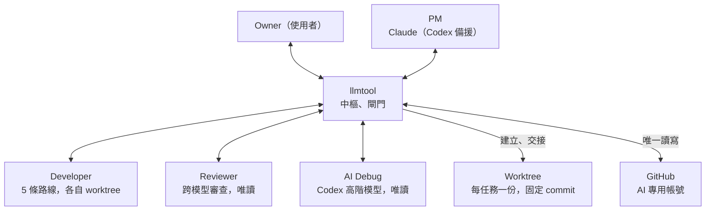
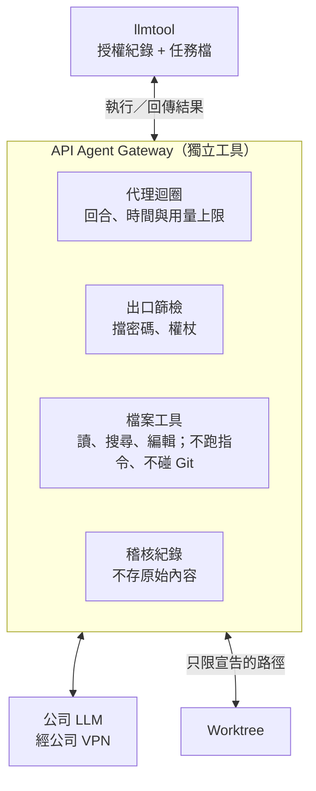
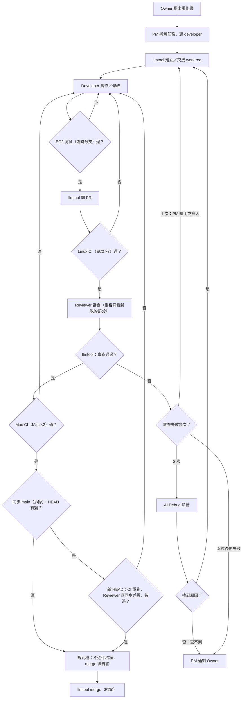

# llmtool 新架構定稿：以 llmtool 為中樞的 AI 開發流程

> **文件性質：** Owner 架構決策彙整與遷移建議（docs-only；本文件不改任何 runtime、policy、CI 或派工設定，也不構成執行授權）
>
> **日期：** 2026-11-06（Asia/Taipei）
> **Repository：** davidcatcat/davidcattoolsproject
> **作者角色：** Claude（claude.ai 對話），依 Owner 2026-11-05 至 11-06 逐段口述的流程整理，並對照當日 main 核實現況
> **Owner 決策紀錄：** 第 9 節的決定由 Owner 在對話中確認；依 [CLAUDE.md](../../CLAUDE.md) 的 Owner channel 規則，PM 需另行在 Task/Issue 上轉記（`actor=PM`）後才算正式紀錄
> **與其他報告的關係：** 參考 [資源感知報告](llmtool-resource-efficient-ai-delivery-research-and-rollout-20261103.md)（PR #877）後，Owner 決定**不採用**其 Scheduler、Evidence Graph 等提案
>
> **2026-11-06 更新（[規則檔與權限](https://github.com/davidcatcat/davidcattoolsproject/issues/1019#issuecomment-6668770028)、[自動安裝](https://github.com/davidcatcat/davidcattoolsproject/issues/1019#issuecomment-6669350210)，#1019）：** Owner 後來改了兩項決定。規則檔（敏感檔案清單所列）的 PR 不再逐件核准，merge 後在監控上方告警，Owner 看過後請 PM 清除。 llmtool 新版維持自動安裝（本機 repo 快轉到 main），沒有 Owner 按鍵，也沒有 self-update 工具。AI 不使用 sudo、su、root；帳號、密碼、憑證、金鑰需 Owner 明確授權。以下相關文字已依此更新。

---

## 1. 概要

llmtool 是所有角色之間唯一的中樞，也是 GitHub 唯一的讀寫出口；需要判斷的事交給 PM，能照規則擋的事由 llmtool 機械式處理。

設計原則：

- 角色之間不直接溝通，全部經過 llmtool 轉送。
- 角色不碰 GitHub：讀寫程式碼都在 llmtool 準備的 worktree 裡，GitHub 權杖只放在 llmtool。
- 機械式、不能被說服的檢查放 llmtool；需要判斷的交給 PM。
- merge 進 main 的每一行程式碼都被跨模型 Reviewer 審過。
- AI 可以修改 llmtool；新版 merge 後自動安裝（本機 repo 快轉到 main）。
- 結案不通知 Owner；只有失敗到底、規則檔變更、超時或系統異常才通知。

不經過 llmtool 的只有：各 AI 呼叫自己的模型（llmtool 只負責啟動、給 worktree、收結果）、GitHub 依 push／PR 觸發的 CI（結果仍由 llmtool 取回判斷）、外部監控（必須在 llmtool 之外）、ChatGPT 顧問（在系統之外，只與 Owner 討論）。

## 2. 角色連接架構

Developer 在自己的 worktree 修改；Reviewer 與 AI Debug 拿同一 commit 的唯讀版本。推分支、開 PR、發審查、merge 都由 llmtool 代做。

## 3. AI 配置

PM 由 Claude 擔任，Claude 不可用時由 Codex 暫代；Reviewer 一律跟寫程式的 AI 不同家。

| 角色 | AI | 說明 |
| --- | --- | --- |
| PM | Claude（主要） | 拆解需求、派工、選 developer、卡住時判斷 |
| PM | Codex（備援） | 只在 Claude 不可用時暫代 |
| Developer | Codex | 主力 |
| Developer | Claude | 一般可選路線；獨立工作階段與 worktree，不能是 PM 順手改 |
| Developer | OpenCode | 免費模型 |
| Developer | AGY | 底層為 Gemini 4 Argon |
| Developer | 公司 LLM | 經 API Agent Gateway 在 worktree 裡讀寫，用法同 Codex、Claude |
| Reviewer | Claude | 審 OpenAI 系模型（Codex）、Gemini（AGY）、OpenCode 寫的程式碼 |
| Reviewer | Codex | 審 Claude 系模型（Claude）、公司 LLM 寫的程式碼；Claude 不可用時，AGY 與 OpenCode 也可由 Codex 審 |
| AI Debug | Codex 高階模型 | 唯讀除錯，每個任務最多介入一次 |
| 顧問 | ChatGPT | Owner 的技術顧問，不接入 llmtool、不派工 |

Reviewer 配對規則：

- **看實際模型，不看路線名稱：** llmtool 在正式審查前驗證 developer 實際使用的模型家族、reviewer 實際模型、`worker-dispatch.json` 授權狀態與工作階段獨立性；任何一項不滿足就不接受正式 PASS。上表是依各路線目前的預設模型推得的配對，例如 AGY 底層是 Gemini 4 Argon，所以由 Claude 審。
- **OpenCode 預審保留：** 沿用現行規則，OpenCode 交付前仍須先過一次實際免費、跨模型家族的預審；預審不是正式審查。

PM 備援規則：

- **切換時機：** llmtool 偵測到 Claude PM 心跳逾時、額度用完或登入失效，重試一次仍不行就切到 Codex。
- **交接：** 任務狀態存在 llmtool（TaskStore），不存在 Claude 的對話裡，Codex 讀紀錄接手。
- **單一 PM：** 同一時間只能有一個 PM；Claude 恢復後，等 Codex 手上的判斷告一段落再切回。
- **通知：** 切換時通知 Owner 一次。
- **暫代 PM 不寫程式：** Codex 暫代期間只負責派工與管理，不直接修改程式碼或文件；所有改動都交給 developer，走正常的跨模型審查。
- **避免審查卡死：** Claude 不可用時，Codex 寫的程式碼沒有合格的跨模型 Reviewer，所以暫代 PM 派工時避開 Codex developer，改派由 Codex 審的路線（OpenCode、AGY 等）。某個任務若找不到合格的跨模型 Reviewer，就標記為等待並記下恢復條件，不得自行放行；其他可執行的任務照常進行。

## 4. 公司 LLM 接入

**目標：** 公司 LLM 做真實任務，透過 [API Agent Gateway](../../tools/api-agent-gateway/README.md)（`gw-agent`）在 worktree 裡工作，跟 Codex、Claude 一樣走完整流程。

**現況（2026-11-06）：** gateway 仍是 Phase 1 離線 MVP，只有對假伺服器的測試證據，尚未有真實 provider 呼叫驗證；`gw-agent` 目前只授權 synthetic 測試內容。本節描述的是遷移第 6 步完成後的狀態，不是已完成的能力。

gateway 只靠 CLI／JSON 跟 llmtool 溝通；llmtool 每次執行前寫一份 15 分鐘內有效的授權紀錄。測試跟其他 developer 一樣由 llmtool 跑。舊的提案模式（一次送資料、回傳 diff）等 gateway 功能完成後移除。

## 5. llmtool 核心功能與 PM 分工

| 歸屬 | 功能 | 內容 |
| --- | --- | --- |
| llmtool | 中樞與工作區 | 訊息轉送、建立與交接 worktree、寫入權租期 |
| llmtool | GitHub 閘門 | 推分支、開 PR、發審查、merge、回退 |
| llmtool | 測試關卡 | 取回 EC2 與 CI 結果、同步 main、失敗計次、merge 排隊 |
| llmtool | 保護與監控 | 規則檔 merge 後告警、心跳與總時限、PM 備援切換 |
| PM | 需要判斷的事 | 拆解需求、選 developer、卡住時重試／換人／隔離、判斷程式或環境問題、找 AI Debug、通知 Owner |
| Owner | 保留的決定 | 帳號、密碼、憑證、金鑰的授權；看過規則檔告警後請 PM 清除 |
| 外部監控 | llmtool 之外 | EC2 上的排程檢查，llmtool 掛了直接通知 Owner |

保護與監控發現卡住時通知 PM 判斷；規則檔告警與超時繞過 PM 直接讓 Owner 看到，因為它們本來就是在防 AI 出錯。

## 6. 工作流程

- 三道測試由便宜到昂貴：EC2 擋明顯錯誤、Linux CI 通過才送審、Mac CI 留給已過審的程式碼。
- 測試或同步失敗都退回 developer，不計審查次數。只有 runner、網路、環境異常或疑似不穩定的測試，才在同一 commit 重跑一次；確定是程式錯誤的直接退回，不重跑。
- 同步 main 若改變了 HEAD（包含解衝突），舊 commit 的審查與 CI 結果都不能沿用：新 HEAD 必須重跑必要 CI，並由 Reviewer 對新 HEAD 給出正式結果（可以只看同步帶進來的差異，但 PASS 必須綁定新的完整 HEAD）。
- 任何 developer 修改後都從 EC2 重新走一遍；審查與 CI 一律對最新 commit（exact-head）。
- 沒碰規則檔時，merge 後沒有告警。

## 7. 失敗、迴圈與卡住

每個迴圈都要有上限，每個等待都要有時限；次數一律跟著任務算，不跟著 AI 算。

防止無限迴圈：

| 情況 | 規則 |
| --- | --- |
| 審查失敗後換 developer | 失敗次數跟著任務累計，換人不歸零 |
| 測試或同步失敗 | 整個任務的測試失敗總數有上限，超過就通知 Owner；不是每一關各自算。上限數字是待定的實作參數，定案前這條迴圈還不算有完整上限 |
| 環境異常或疑似不穩定的測試 | 只有這類失敗才在同一 commit 重跑一次，兩次都失敗才退回；確定是程式錯誤的直接退回 |
| main 一直在變 | merge 排隊，同一時間只讓一個任務做「同步 main、重測、merge」 |
| merge 後 main 壞掉 | 先回退那次 merge，PM 再開新任務修 |

防止卡住：

| 卡住的情況 | 處理 |
| --- | --- |
| 角色沒回應（逾時） | 重試一次，再不行由 PM 換另一個 AI |
| AI 額度用完 | 記錄進度、暫停，PM 換人或等額度恢復 |
| 沒有可用的 developer | 任務標成等待並記下恢復條件，超過時限通知 Owner |
| Runner 或 EC2 連不上 | 等一段時間重試，持續不通就通知 Owner |
| worktree 交接時舊的不放手 | 寫入權有租期，到期自動收回 |
| Claude 不可用、審查卡死 | 見第 3 節 PM 備援規則 |
| 規則檔告警 | 留在監控上方，直到 Owner 請 PM 清除 |
| llmtool 本身掛掉 | 任務狀態存在硬碟，重啟後從斷點繼續；外部監控通知 Owner |
| 任何任務太久沒結案 | 超過總時限直接通知 Owner，不經過 PM |

PM 收到卡住通知後，沿用 [PM Continuation](../../skills/ai-team-delivery/pm-continuation.md) 的做法：先用錯誤代碼、任務、時間確認原因；再分成暫時性、AI 不可用、環境問題、程式問題、需要 Owner 決定五類處理；只影響這個任務，其他任務照常進行。

## 8. CI 與測試機器

GitHub 付費託管 runner 已停用，Actions 只負責把 job 派給自架 runner。三道測試都由 llmtool 取回結果，並確認是這次 commit 的結果。

| 關卡 | 位置 | 觸發方式 | 時機 |
| --- | --- | --- | --- |
| EC2 測試區 | EC2，跟 runner 分開的帳號與資料夾 | llmtool 經 SSH 執行，只跑相關模組 | 推臨時分支後、開 PR 前 |
| Linux CI | EC2 上 3 個 runner | 開 PR 後自動觸發，跑全套 | 審查前 |
| Mac CI | Owner Mac 上 2 個 runner | 審查通過後觸發 | merge 前 |

- **EC2 測試的程式碼來源：** llmtool 先把 worktree 推到 GitHub 的臨時分支（不開 PR；`llmtool Linux CI` 只在 PR 與 main push 觸發，所以不會佔用 runner），EC2 從那裡下載測試，通過後才開 PR。現行做法是先開 PR 再跑 EC2；`run_remote_test` 的 `pr` 參數本來就是選填，改動小。
- **與原先 A 方案的差異：** Owner 最初選的 A 方案是「推上 GitHub 之前」就在 EC2 測試。了解現行 remote-test 是從 GitHub 取得指定 commit 後，Owner 改採臨時分支做法（「先按照你的做法」）。兩者的目標相同，都是開 PR 前先擋掉便宜的錯誤；差別在於臨時分支做法下，程式碼會先推到 GitHub，但不觸發 CI、也不開 PR。好處是不用另外開發把程式碼傳到 EC2 的機制。
- **外部監控：** 放在 EC2 上用排程定期檢查 llmtool，不在 Mac 上常駐背景程式。

## 9. 決定紀錄

以下為 Owner 在 2026-11-05 至 11-06 對話中確認的決定（待 PM 轉記）。

| 主題 | 決定 |
| --- | --- |
| 中樞 | 所有角色只透過 llmtool 溝通 |
| GitHub | 只有 llmtool 能讀寫，使用 AI 專用帳號（#926 安排上線） |
| 程式碼存取 | 角色讀寫 llmtool 建立的 worktree，不直接碰 GitHub |
| 審查失敗 | 第 1 次退回，PM 可決定續用原 developer 或換人；第 2 次交 AI Debug |
| AI Debug | 查不到原因，或除錯後仍審查失敗，PM 通知 Owner（已由 D3/D4 取代，見 #1502） |
| 審查判斷 | 由 llmtool 照 Reviewer 結果走，PM 不能推翻（已由 O3 爭議處理程序取代，見 #1502） |
| 重審 | 只看上次審查後新改的部分；merge 前的每一行都要被審過 |
| 測試失敗 | EC2、Linux CI、Mac CI、同步 main 失敗都直接退回 developer，不計審查次數 |
| Mac CI 失敗後 | 修改後要重新審查 |
| 修改後 | 任何修改都從 EC2 重新走一遍 |
| 結案 | 不通知 Owner；進度由 Owner 自己詢問 |
| merge 前 | llmtool 同步 main；HEAD 有變就重跑 CI，並由 Reviewer 對新 HEAD 給出正式結果；有衝突或重測失敗才退回（已由 M1 取代：merge 前不同步 main，見 #1317、#1502） |
| Reviewer 配對 | 依實際模型家族由 llmtool 驗證，不滿足就不接受 PASS |
| OpenCode 預審 | 保留現行的免費跨模型預審 |
| 測試重跑 | 只有環境異常或疑似不穩定的測試才重跑一次；程式錯誤直接退回 |
| merge 後壞掉 | 回退，再開新任務修 |
| 程式碼送外部 AI | 一般專案原始碼可依 Owner 授權交給各 AI 路線，不另設限制；密碼、權杖、私鑰一律不得外傳；個資、客戶資料、受限制日誌仍依 [CLAUDE.md](../../CLAUDE.md) 的資料保護規則處理；變更既有的資料外傳權限（例如 `gw-agent` 的資料類別）仍須走授權程序 |
| 公司 LLM | 開放真實任務，經 API Agent Gateway，用法同 Codex、Claude |
| 舊提案模式 | gateway 功能完成後移除 |
| 平行任務 | 依 Git 規則與精神：一任務一分支、PR 盡量小、後 merge 的解衝突 |
| llmtool 自我更新 | 新版 merge 後自動安裝（本機 repo 快轉到 main），沒有 Owner 按鍵 |
| 選 developer | 由 PM 選 |
| PM 備援 | Claude 為主，Codex 在 Claude 不可用時暫代；暫代 PM 不寫程式，找不到合格 Reviewer 的任務標記等待 |
| EC2 測試時機 | 推臨時分支、不開 PR 先測，通過才開 PR（取代原先「推上 GitHub 前測試」的 A 方案，見第 8 節） |
| #877 | 不採用 Scheduler、Evidence Graph 等提案 |

**規則檔清單（Owner 授權先由 AI 團隊決定，有疑問再問）：** llmtool 閘門與權限檢查程式、權限設定檔（例如 `worker-dispatch.json`）、權杖與帳號相關程式、CI 設定與 runner 安裝腳本、規則檔清單本身。改到這些檔案的 PR 不需逐件核准，merge 後在監控上方告警。

## 10. 遷移建議

原則：不停掉現有系統，讓現在的 llmtool 一步一步把自己改成新架構；每一步都可停止、可回退。

已有、可沿用：D6 worktree 與單一寫入者、TaskStore、`worker-dispatch.json`、跨模型審查閘門（#846）、Linux 與 Mac CI、EC2 remote-test、High Debug、API Agent Gateway、Codex PM 轉接器（#807）、AI 專用帳號計畫（#926）。

| 順序 | 內容 | 說明 |
| --- | --- | --- |
| 0 | 盤點缺口（唯讀） | PM 逐條對照本文件與 main，列出已有／要改／要新做，並對到現有 Issue 去重 |
| 1 | 先上保護 | 規則檔清單與 merge 後監控告警。必須最先做：後面每一步都是 AI 在改 llmtool 的閘門 |
| 2 | 只改設定 | Claude developer 改成一般路線；決定紀錄寫進 `CLAUDE.md`、`AGENTS.md` |
| 3 | GitHub 只走 llmtool | 配合 #926 上線 AI 帳號，收回各角色直接寫 GitHub 的路徑；分多個 PR；完成條件見下方負面測試 |
| 4 | 流程調整 | EC2 改在開 PR 前、審查結果由 llmtool 判斷、失敗次數跟著任務算、不穩定測試先重跑、merge 排隊與回退 |
| 5 | 卡住的出口 | 任務總時限直接通知 Owner、EC2 外部監控、PM 自動切換 Codex 備援 |
| 6 | 公司 LLM | gw-agent 解除只限 synthetic 的限制、開放真實任務，穩定後移除舊提案模式 |

第 3 步的驗收條件：「角色不碰 GitHub」不能只靠規定，例如 developer 若有 shell 又與 llmtool 共用作業系統帳號，就可能讀到 Git 憑證、`gh` 設定或環境變數而繞過中樞。完成前必須有實際的負面測試證明：

- AI developer、reviewer 的執行環境取不到任何 GitHub 權杖。
- 在 worktree 內直接執行 `git push` 或 `gh pr create` 會被擋下。
- llmtool 仍能正常推分支、開 PR、發審查、merge。
- AI 專用帳號與 Owner 帳號的憑證分開存放，不會互相使用。

## 11. 待辦事項

- [ ] PM 轉記第 9 節 Owner 決策
- [ ] 第 0 步缺口盤點
- [ ] 規則檔清單寫成 llmtool 規則，merge 後在監控上方告警
- [ ] llmtool 新版 merge 後自動安裝
- [ ] EC2 測試改成「推臨時分支、不開 PR」後再測
- [ ] PM 備援：偵測 Claude 不可用、切換 Codex、單一 PM 鎖、切回規則
- [ ] 失敗次數跟著任務累計；決定測試失敗總數上限
- [ ] 測試失敗分類：環境異常或疑似不穩定才同 commit 重跑一次
- [ ] 同步 main 改變 HEAD 時，重跑 CI 並對新 HEAD 取得正式審查
- [ ] llmtool 驗證 reviewer 配對的實際模型家族
- [ ] GitHub 憑證隔離的負面測試（第 10 節第 3 步驗收條件）
- [ ] merge 排隊與 merge 後回退
- [ ] worktree 寫入權租期
- [ ] 任務總時限，超過直接通知 Owner
- [ ] 外部監控：EC2 上的排程檢查
- [ ] AI 專用帳號照 #926 上線
- [ ] gw-agent 開放真實任務
- [ ] gateway 完成後移除公司 LLM 舊提案模式
- [ ] 規劃書另案討論
